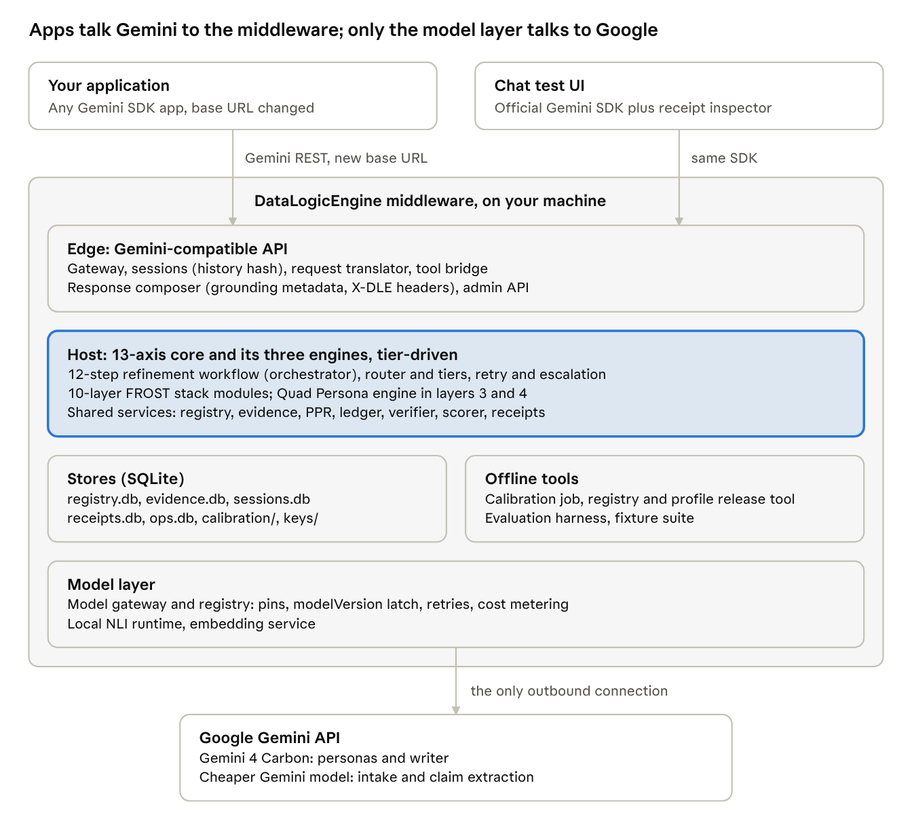
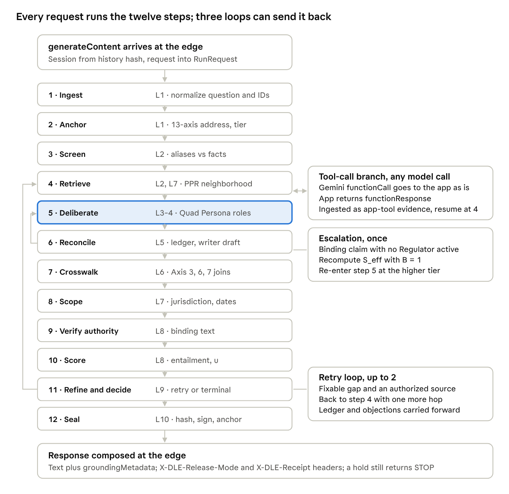

# DataLogicEngine 13-Axis Middleware — Application Blueprint

Nov 20, 2026 · @kevin herrera

## Purpose and scope

The middleware runs the 13-axis DVSS design from white paper v3.13 behind
an API that looks exactly like Google's Gemini API. An application
switches to it by changing its base URL and API key, nothing else.

**What it does on every request:** gives the question a 13-axis address,
retrieves bounded evidence, runs the roles the tier calls for, checks
each claim against sources in host code, then releases, holds or asks
for review, and signs a receipt.

**Design constraints**

| Constraint                 | Decision                                                                                                                |
|----------------------------|-------------------------------------------------------------------------------------------------------------------------|
| Client interface           | Gemini API compatible: generateContent, streamGenerateContent, models, countTokens                                      |
| Backing model              | Gemini 4 Carbon for roles and writer; a cheaper Gemini model for intake and claim extraction                            |
| Verification               | A local pinned NLI model, never the generator                                                                           |
| Gemini tools and functions | All passed through, never blocked. Function results become evidence.                                                    |
| Conversation identity      | Hash of the canonical history, scoped by tenant, model and system instruction. Optional X-DLE-Session header overrides. |
| Deployment                 | Installed on a workstation, server or VM. The only outbound connection is to the model provider. No telemetry.          |
| Receipts                   | Local WORM storage with Merkle checkpoints by default; customer or external logs later                                  |
| Testing                    | A chat UI built on the official Gemini SDK, pointed at the middleware, with a receipt inspector                         |

**Out of scope for v1:** multi-node clustering, a billing system, and
model providers other than Gemini (the model gateway keeps that door
open).

## The three core engines

The host is built around three engines from the white paper, and the
tier decides how much of each one a question gets. The **12-step
refinement workflow** sets the order of work. The **10-layer FROST
stack** sets who is responsible for each kind of work. The **Quad
Persona engine** supplies the four expert perspectives inside layers 3
and 4. Everything else in the host is a shared service these engines
call.

### 12-step refinement workflow (§12)

A state machine that runs every request. Steps 4–11 can loop: when step
11 finds a fixable evidence gap with an authorized source, the run
re-enters step 4 with a wider neighborhood and the objection ledger
carried forward. A binding claim in a draft without the Regulator
triggers one escalation back to step 5 at the higher tier.

| Step                   | Layers | What the engine does                                                                                  |
|------------------------|--------|-------------------------------------------------------------------------------------------------------|
| 1 · Ingest             | 1      | Capture the question, normalize identifiers                                                           |
| 2 · Anchor             | 1      | Resolve pillars, sectors, site and current documents into the 13-axis address                         |
| 3 · Screen             | 2      | Reject unknown aliases as facts; tag proposals as hypotheses                                          |
| 4 · Retrieve           | 2, 7   | PPR diffusion from anchors, access and time limits, hydration                                         |
| 5 · Deliberate         | 3–4    | Quad Persona engine runs the tier's roles on one proposal ID                                          |
| 6 · Reconcile          | 5      | Normalize and align claims, open objections, compare options                                          |
| 7 · Crosswalk          | 6      | Join across Axis 3, 6 and 7 crosswalks                                                                |
| 8 · Scope              | 7      | Re-check jurisdiction and effective dates on every issued claim                                       |
| 9 · Verify authority   | 8      | Fetch authoritative text for each binding claim                                                       |
| 10 · Score             | 8      | Extract atomic claims, score entailment and freshness, compute u                                      |
| 11 · Refine and decide | 9      | Retry if a fixable gap remains; otherwise pick the terminal candidate and apply the release rule once |
| 12 · Seal              | 10     | Hash the returned bytes, sign, anchor, release or hold                                                |

### 10-layer FROST stack (§11)

Ten layer modules, each owning one responsibility and writing one
durable artifact into the run state. A layer can run more than once per
request, and a step can use more than one layer. Each attempt appends to
the run state; nothing earlier is overwritten.

| Layer                      | Owner           | Module job                                                                       | Writes                                  |
|----------------------------|-----------------|----------------------------------------------------------------------------------|-----------------------------------------|
| 1 · Grounding              | Host            | Validate anchors, compute tier and active-axis mask                              | Address, tier, uncertain matches        |
| 2 · Graph                  | Host            | Select the scoped spine neighborhood, add session hypotheses, hydrate            | Graph revision, source manifest         |
| 3 · Profiles               | Host            | Match eligible persona profiles, allocate role budgets, seal role packets        | Packet manifests per role               |
| 4 · Perspectives           | Model           | Run each persona on its sealed packet                                            | Role findings and objections            |
| 5 · Arbitration            | Host and model  | Merge normalized claims, enforce veto state, compare options                     | Claim and objection ledger              |
| 6 · Alignment              | Host and model  | Reconcile terms and provenance across crosswalks                                 | Resolved and unresolved interpretations |
| 7 · Scope                  | Host            | Check jurisdiction and effective intervals per claim                             | Applicability or missing premise        |
| 8 · Verification           | Host and scorer | Independent claim extraction, authority checks, entailment, score u              | Verified claim records                  |
| 9 · Refinement and release | Host            | Decide retry before reading the cutoff, then apply hard checks, cutoff and drift | Terminal decision                       |
| 10 · Receipt               | Host            | Hash, sign, anchor, persist evidence references, purge session data              | Signed receipt                          |

### Quad Persona engine (§07–§10)

Four roles, each tied to an axis: Scholar (8), Practitioner (9),
Regulator (10) and Harmonizer (11). For every request the engine picks a
profile per active role, sizes its budget, builds its evidence packet
and runs it.

1.  **Activate roles** from the tier, plus the Regulator for any binding
    claim and the Harmonizer when an Axis 7 entry applies.

2.  **Select a profile** per role from the MDKF profile store: mandatory
    qualifications filter first, then the match score M = 0.25E +
    0.45C + 0.30X ranks, with a stable tie-break. Profiles carry seven
    fields: job role, education, certifications, technical skills,
    training, career path and related jobs.

3.  **Allocate budgets** by the share of PPR mass in each role's
    neighborhood.

4.  **Seal packets**: each role sees the question, its mandate, a
    role-filtered evidence packet and the shared proposal ID. In blinded
    mode the Regulator and Harmonizer see the proposal before the
    advocates' arguments.

5.  **Run and record**: each role returns claims, passage links,
    assumptions, disconfirming observations and objections in the
    structured artifact. The host validates every ID against the packet.

### How the tier drives all three

| Setting                 | Tier 1 (S_eff 0–2)                      | Tier 2 (3–5)                                                          | Tier 3 (6–9)                                              |
|-------------------------|-----------------------------------------|-----------------------------------------------------------------------|-----------------------------------------------------------|
| Personas                | Scholar                                 | Scholar and Practitioner                                              | All four when B or Z is set; otherwise the relevant roles |
| Added on demand         | Binding claim forces escalation         | Regulator for binding claims; Harmonizer when an Axis 7 entry applies | —                                                         |
| Starting hops (layer 2) | 1                                       | 2                                                                     | 2                                                         |
| Blinded assurance roles | —                                       | Policy option                                                         | Policy option                                             |
| Retries (step 11)       | Up to 2, one hop added each, 4 hops max | Same                                                                  | Same                                                      |
| Escalation              | Once, to S_eff recomputed with B = 1    | Once, if a binding claim appears without the Regulator                | —                                                         |
| Model calls, worst case | 9, or 21 if escalated                   | 12 to 18, or 22 if escalated                                          | 18                                                        |

S_eff = max(S, 3B, 6Z), computed in layer 1 from intake scores for
complexity, binding predicates, regulatory exposure and the risk check.

## Function bindings

The three engines act through 26 bound functions, dispatched by a new
component, **H16 Function registry**. Twelve kernel functions
(DVSS-K01–K12) always run and cannot be switched off. Fourteen policy
functions (DVSS-P01–P14) run when the release profile enables them. The
100-slot KA catalog, and KA-101–KA-114, load as read-only inventory with
no execution rights.

| Level   | Count                             | Who decides                                               | Example                                                                    |
|---------|-----------------------------------|-----------------------------------------------------------|----------------------------------------------------------------------------|
| Kernel  | 12                                | Fixed in host code; service will not start without all 12 | K04 Hard and CRC gate, K09 Two-retry limit, K12 Unresolved compliance veto |
| Policy  | 14                                | Release profile, by DVSS ID                               | P02 Pareto options, P07 Binding escalation, P12 Drift monitoring           |
| Catalog | 74 of KA-001–100, plus KA-101–114 | Nobody; inventory only                                    | KA-024 Trust Gate (its Can_Veto flag is ignored)                           |

Four rules make it safe:

1.  **Dispatch by DVSS ID.** A KA number never selects or authorizes
    code, because legacy numbers collide with enterprise titles (KA-015
    is Temporal Reasoning in the registry but K05 evidence acquisition
    here).

2.  **Adapter gate.** An external implementation is enabled only when
    version, input and output schema hashes, scope and permissions all
    match the binding record.

3.  **Required host fallbacks.** P07 escalation, P08 role token
    allocation and P12 drift gating always have host code behind them,
    so disabling the module never skips the behavior.

4.  **Only three functions can hold.** K04, K11 and K12 may stop a
    release; veto authority comes from the K12 objection ledger alone.

Every invocation is recorded in the run state and listed in the receipt.
Two shipped profiles, kernel_only and kernel_plus_policy, give the §17
ablation its two arms. The full binding tables, with hooks, components
and profile defaults, are in the Software Development Documentation Set,
§6.

## System context

system context · clients, five layers, one outbound connection

Applications and the test UI reach the middleware through the same
Gemini REST surface. Inside, the host core does the 13-axis work; only
the model layer calls out, to Google.

## Component map

The application has 31 components in five layers. Each has one job and
one owner module, so Codex can build and test them one at a time. Paper
sections are from v3.13.

| ID  | Component             | Layer   | Job                                                                                                             | Paper             |
|-----|-----------------------|---------|-----------------------------------------------------------------------------------------------------------------|-------------------|
| E1  | API gateway           | Edge    | Serves the Gemini REST routes, checks middleware API keys, handles SSE streaming and keepalives                 | —                 |
| E2  | Session resolver      | Edge    | Hashes the canonical history to find or open a session; honors X-DLE-Session                                    | —                 |
| E3  | Request translator    | Edge    | Turns contents, systemInstruction, tools and generationConfig into a run request                                | —                 |
| E4  | Tool bridge           | Edge    | Forwards Gemini tools to the model, returns functionCall parts to the app, ingests functionResponse as evidence | —                 |
| E5  | Response composer     | Edge    | Builds the Gemini response: released text, groundingMetadata, finishReason, X-DLE-\* headers                    | §16c              |
| E6  | Admin API             | Edge    | Source registration, registry releases, calibration loading, key management, receipts lookup                    | —                 |
| H1  | Run orchestrator      | Host    | Drives one run through the twelve steps, enforces retry and escalation limits                                   | §11–§12           |
| H2  | Intake and router     | Host    | Scores S, R, B and Z, computes S_eff and the tier                                                               | §07               |
| H3  | Registry and spine    | Host    | Loads axis registers and the UKG spine, versioned by manifest digest; alias pairs                               | §02, App. A–C     |
| H4  | Coordinate resolver   | Host    | Builds and validates the 13-axis address with slot states                                                       | §02–§04           |
| H5  | Evidence service      | Host    | Stores dated, versioned passages; full-text and vector search; hydration                                        | §07               |
| H6  | Graph packer          | Host    | PPR diffusion, hop limits, vertex, edge and token bounds                                                        | §06               |
| H7  | Session overlay       | Host    | Per-session working graph (USKD): selected vertices, temporary nodes, hypotheses                                | §06               |
| H8  | Role orchestrator     | Host    | Selects profiles, builds role packets, runs Scholar, Practitioner, Regulator and Harmonizer                     | §08–§09           |
| H9  | Writer                | Host    | Produces the candidate answer from role findings and evidence                                                   | §10               |
| H10 | Claim extractor       | Host    | Pulls atomic claims from the draft and role outputs; checks each maps to a text span                            | §16a              |
| H11 | Objection ledger      | Host    | Append-only objections; only the verifier closes                                                                | §09–§10           |
| H12 | Verifier              | Host    | Entailment, authority checks for binding claims, the hard gate H                                                | §16a              |
| H13 | Scorer                | Host    | Computes the terminal score u                                                                                   | §16a              |
| H14 | Release controller    | Host    | Applies the calibrated cutoff, drift latch and release profile                                                  | §16b–§16c         |
| H15 | Receipt service       | Host    | JCS payload, Ed25519 signature, WORM store, Merkle checkpoints, anchoring profiles                              | §16d              |
| H16 | Function registry     | Host    | Dispatches DVSS-K01–K12 and enabled P01–P14 by ID; startup checks, adapter gate, FunctionRecord per call        | Function bindings |
| M1  | Model gateway         | Model   | One interface for all model calls: Gemini adapter, retries, rate limits, cost metering                          | —                 |
| M2  | Model registry        | Model   | Pins model IDs per job, records modelVersion, latches calibration on change                                     | §16c              |
| M3  | NLI runtime           | Model   | Local pinned entailment model                                                                                   | §16a              |
| M4  | Embedding service     | Model   | One pinned embedding model for search and the risk check                                                        | §07               |
| O1  | Calibration job       | Offline | Builds the signed calibration artifact from graded queries                                                      | §16b              |
| O2  | Registry release tool | Offline | Validates and publishes a new registry version                                                                  | §06               |
| O3  | Evaluation harness    | Offline | Runs the §17 study arms and metrics                                                                             | §17               |
| O4  | Fixture suite         | Offline | The §18 conformance tests, run on every build                                                                   | §18               |
| C1  | Chat test UI          | Client  | Chat on the official Gemini SDK plus a receipt inspector panel                                                  | —                 |

Three things cut across every layer: configuration and policy (release
profile, model pins, function flags), local structured logs and metrics
with no telemetry, and the key store for signing keys and the provider
key.

## Request lifecycle

request lifecycle · 12 steps, FROST layers, tool branch, escalation and
retry

Each box is one refinement step, tagged with the FROST layers it uses;
step 5 is where the Quad Persona engine runs. The tier set in step 1
decides how many roles step 5 calls and how wide step 4 searches; the
three side boxes are the only ways a run goes backwards.

## Data stores

Five SQLite databases and two file folders hold everything. Splitting
them by write pattern keeps the append-only receipt store simple and
lets the spine stay read-only during runs.

| Store        | Holds                                                                                          | Written by  | Write pattern                                      |
|--------------|------------------------------------------------------------------------------------------------|-------------|----------------------------------------------------|
| registry.db  | Axis registers, spine vertices and edges, crosswalks, alias pairs, manifest digest per version | O2          | New version per release; read-only at runtime      |
| evidence.db  | Sources, dated passage versions, authority records, full-text index, vector index              | H5, E4, E6  | Append new versions; never edit a passage in place |
| sessions.db  | Session keys, history hashes, overlay graphs, objection ledgers, turn index                    | E2, H7, H11 | Read and write per turn; expires on a schedule     |
| receipts.db  | Signed receipts, chain links per session, Merkle tree nodes, exported checkpoints              | H15         | Append only; WORM at the file level                |
| ops.db       | Model call log with modelVersion, token counts, cost, latency, drift monitor state             | M1, M2, H14 | Append                                             |
| calibration/ | Signed calibration artifacts: n, α, cutoff, μ₀, drift parameters, model and registry pins      | O1          | New file per calibration                           |
| keys/        | Ed25519 signing keys with validity intervals, the Gemini API key, middleware client keys       | E6          | Rotated on schedule; encrypted at rest             |

Nothing leaves the machine except model calls. Passages sent to Gemini
are the ones the source policy allows; that limit is set per source in
evidence.db.

## Technology stack

The backend is one Python 3.12 service; the test UI is a separate
TypeScript app. Every library below runs offline except the Gemini
client.

| Area           | Choice                                                                           | Used by     | Why                                                 |
|----------------|----------------------------------------------------------------------------------|-------------|-----------------------------------------------------|
| Language       | Python 3.12, fully typed                                                         | All backend | Matches the pilot; strong ML and crypto libraries   |
| Web framework  | FastAPI on Uvicorn                                                               | E1, E6      | Async, OpenAPI out of the box                       |
| Streaming      | sse-starlette                                                                    | E1          | SSE with keepalive comments                         |
| Data models    | Pydantic v2, generated from the JSON schemas in contracts/ (coordinate 3.7.1, receipt 3.8.0, role/prompt/registry 1.0.0) with datamodel-code-generator | All         | One source of truth for contracts                   |
| Schema checks  | jsonschema with format checking                                                  | H4, H15, O4 | Same validator as the pilot                         |
| Gemini client  | google-genai SDK                                                                 | M1          | Official; same SDK the apps use                     |
| HTTP           | httpx                                                                            | M1          | Async, timeouts, retries                            |
| Database       | SQLite with FTS5 and sqlite-vec                                                  | All stores  | Zero-admin, air-gap friendly, one file per store    |
| Graph math     | NumPy and SciPy sparse matrices                                                  | H6          | Deterministic PPR, already tested in the pilot      |
| NLI model      | DeBERTa-v3 class NLI model, exported to ONNX, run with onnxruntime               | M3          | Pinned weights, CPU capable, reproducible           |
| Embeddings     | One pinned model (Gemini embedding API or a local ONNX model)                    | M4          | Pin chosen at calibration; local option for air-gap |
| Canonical JSON | rfc8785                                                                          | H15         | JCS for receipt payloads                            |
| Signing        | cryptography (Ed25519)                                                           | H15         | Standard, audited                                   |
| Logging        | structlog to local JSON files                                                    | All         | Structured, no telemetry                            |
| Tests          | pytest, hypothesis, the pilot fixtures                                           | O4          | Property tests for ledger and router invariants     |
| Packaging      | uv for dependencies; Windows installer or a container image                      | Deploy      | Fits install-on-a-machine delivery                  |
| Test UI        | React with Vite, TypeScript, @google/genai SDK                                   | C1          | Proves any Gemini app works unchanged               |
| Lint and types | ruff, mypy, ESLint, tsc in a pre-commit hook                                     | All         | Same gate as your existing repos                    |

## Repository layout and interfaces

One repository, one package per layer. The host never imports the edge,
and nothing but the model gateway talks to a provider, so the host can
be tested with fake models.

dle-middleware/  
contracts/ coordinate.schema.json, receipt.schema.json,
role_artifact.schema.json,  
persona_profile.schema.json, functions/ (k01..k12, p01..p14 in/out),  
gemini/ request and response models  
dle/  
edge/ E1 gateway, E2 sessions, E3 translator, E4 tool bridge, E5
composer, E6 admin  
host/  
workflow/ H1 orchestrator: the 12-step state machine, retry loop, single
escalation  
steps/ s01_ingest.py ... s12_seal.py, one module per refinement step  
frost/ the 10-layer stack, one module per layer  
l01_grounding.py (H2 router, H4 coordinates) l06_alignment.py
(crosswalks)  
l02_graph.py (H5 evidence, H6 PPR, H7 overlay) l07_scope.py  
l03_profiles.py (persona selection, budgets) l08_verification.py (H10,
H12, H13)  
l04_perspectives.py (runs the personas) l09_release.py (H14)  
l05_arbitration.py (H11 ledger, options) l10_receipt.py (H15)  
quad/ H8 Quad Persona engine  
roles.py Scholar (8), Practitioner (9), Regulator (10), Harmonizer
(11)  
profiles.py MDKF seven-field profiles, eligibility filter, M = 0.25E +
0.45C + 0.30X  
packets.py role-filtered evidence, blinded mode, packet digests  
artifact.py role output parsing and ID validation  
functions/ H16 function registry and dispatcher  
registry.py load bindings, startup checks, invoke(dvss_id, ctx),
FunctionRecord  
adapters.py adapter gate: version, schema hashes, scope, permissions  
kernel/ k01_schema.py ... k12_compliance_veto.py (always on)  
policy/ p01_jurisdiction.py ... p14_offline_tuning.py
(profile-controlled)  
tiers.py one table: roles, hops, retries, call budget per tier  
services/ H2 router, H3 registry, H4 coordinates, H5 evidence, H6 graph,
H7 overlay,  
H9 writer, H10 extractor, H11 ledger, H12 verifier, H13 scorer,  
H14 release, H15 receipts  
models/ M1 gateway, M2 registry, M3 nli, M4 embeddings, fakes/ for
tests  
store/ SQLite access and migrations, one module per database  
config/ release profiles (strict, advisory, kernel_only,
kernel_plus_policy),  
functions.yaml, catalog/ (ka100.csv, enterprise_ka114.json),  
tier table, persona profile store, model pins, function flags, source
policy  
offline/ O1 calibrate (P14), O2 registry_release (registry, profiles,
P05), O3 evaluate  
tests/ fixtures/ (O4, the §18 suite), unit/, contract/,
gemini_compat/,  
engines/ (step order, layer coverage, tier fan-out, retry, escalation,
functions)  
ui/ C1 chat test UI (Vite, React, @google/genai): shows tier, roles,
steps, functions per run  
docs/ HANDOFF.md, TODO.md, traceability map from App. G

**Interfaces between parts**

| Interface                                  | Between   | Shape                                                                                                                            |
|--------------------------------------------|-----------|----------------------------------------------------------------------------------------------------------------------------------|
| RunRequest / RunResult                     | Edge → H1 | Query, history, tools, session key, profile → released text, release mode, claims with passage links, function calls, receipt ID |
| ModelPort.generate(job, prompt, schema)    | Host → M1 | Job name picks the pinned model; returns validated JSON plus modelVersion and token counts                                       |
| EntailmentPort.score(claim, passages)      | H12 → M3  | Entailment probability per claim and passage set                                                                                 |
| EvidencePort.search / hydrate / ingest     | H5        | Search by text, vector or address; attach passages to the overlay; add new versions                                              |
| Ledger.merge(objections, verifier)         | H11       | Append-only; closure only through the verifier callback                                                                          |
| ReleasePolicy.decide(H, u, drift, profile) | H14       | Returns one release mode from the §16c table                                                                                     |
| ReceiptService.seal(response, payload)     | H15       | Returns a sealed or pending receipt for the active anchoring profile                                                             |

Each interface gets a fake in models/fakes or tests/, so every host test
runs without network.

## Build phases

Seven phases, each ending in a test that must pass before the next
starts. A working, useful system exists from phase 2.

| Phase                   | Builds                                                                                            | Components                   | Exit gate                                                                                                                                  |
|-------------------------|---------------------------------------------------------------------------------------------------|------------------------------|--------------------------------------------------------------------------------------------------------------------------------------------|
| 1 · Gemini pass-through | Gateway, sessions, translator, tool bridge, composer, model gateway, test chat UI                 | E1–E5, M1, M2, C1            | The official Python and JS SDKs, pointed at the middleware, run text, streaming, multi-turn and function calling exactly as against Google |
| 2 · Verify and gate     | Evidence service, claim extractor, NLI, verifier, scorer, release controller (advisory), receipts | H5, H10, H12–H15, M3, M4, E6 | Released answers carry grounding metadata; unsupported claims hold; receipts verify; fixture tests for gate and receipts pass              |
| 3 · Address and spine   | Registry, coordinate resolver, graph packer, overlay                                              | H3, H4, H6, H7, O2           | Coordinate fixtures pass; PPR retrieval runs behind a switch next to dense retrieval                                                       |
| 4 · Roles and ledger    | Role orchestrator, writer, ledger, orchestrator with retries and escalation                       | H1, H8, H9, H11              | Every §18 fixture passes against real Gemini calls, not injected candidates                                                                |
| 5 · Router              | Intake scoring, binding detection, risk check from development data                               | H2                           | Router fixtures pass; challenge development set measured                                                                                   |
| 6 · Calibration pilot   | Calibration job, strict profile, drift latch                                                      | O1, H14                      | About 100 graded queries at α = .05; coverage and loss reported                                                                            |
| 7 · Full study          | Evaluation harness                                                                                | O3                           | The §17 study runs to its registered plan                                                                                                  |

Phase 4 completes the §18b minimum conforming profile. Appendix G's
untested rules (G1–G11) become Codex tickets inside the phase that owns
each one.

## Open decisions and risks

**Decisions still open**

- [x] Canonical ID for each Axis 1 alias pair (resolved in v3.9 / DLE-REG-001: PL004, PL005, PL006, PL020 are canonical; PL082, PL081, PL084, PL101 remain reserved aliases).

- [ ] Which functions an app may flag as consequential, and the config
  format for flagging them.

- [ ] Embedding model: Gemini embedding API (simpler) or a local model
  (air-gap ready).

- [ ] Session expiry period for sessions.db.

- [ ] Delivery format: Windows installer, container image, or both.

**Risks**

| Risk                                              | Effect                                | Mitigation                                                                            |
|---------------------------------------------------|---------------------------------------|---------------------------------------------------------------------------------------|
| Claim extractor misses a claim                    | That claim never reaches the gate     | Measure recall on a labeled set in phase 2, before building roles                     |
| First-token latency on Tier 3 runs                | Streaming apps wait for the whole run | SSE keepalives; tune tier thresholds on real traffic                                  |
| Gemini 4 Carbon changes without a version change  | Calibration silently goes stale       | Record modelVersion per call; rerun fixtures on a schedule                            |
| Gemini response fields shift between API versions | Apps break on the middleware          | Contract tests in tests/gemini_compat/ against the official SDKs on every build       |
| Function results from apps are wrong              | False evidence passes the gate        | Source class "app tool" with its own weight; consequential calls get Regulator review |
| Grading cost for calibration and the study        | Phases 6 and 7 stall                  | Budget reviewer time before phase 6; start with the 100-query pilot                   |
| Cost per question at Carbon prices                | Expensive at scale                    | Cheaper models for intake and extraction; log real tokens per tier from phase 1       |
