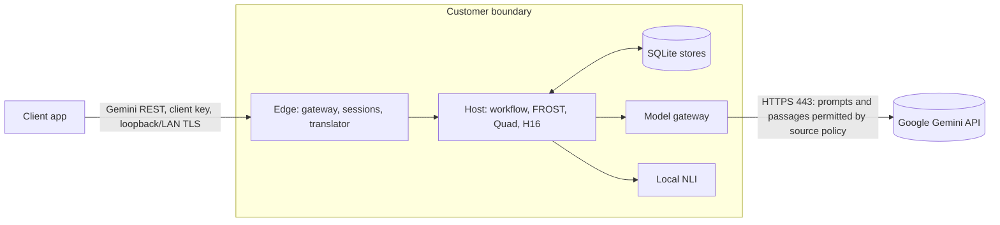

# Product security package (G24, draft)

**Document ID:** DLE-SEC-002 · **Version:** 0.1.0 · **Status:** Draft · **Owner:** Security lead · **Date:** 2026-11-20

For customer security reviews and agency ATOs. The middleware is installed software in the customer's boundary; we operate no service and hold no customer data. Its only outbound connection is to the Gemini API.

## 1. Data flow

**What leaves the machine:** the question, conversation history, system instruction, client tool declarations, and evidence passages whose source policy permits sending. **What never leaves:** keys, receipts, stores, logs, calibration data. Air-gapped operation needs a local model behind the model port (not in v1).

## 2. Egress attestation

| Control | Evidence |
| --- | --- |
| Single egress client, deny by default | `dle/models/egress.py`; CI import check |
| Allowlist = Gemini host (+ optional transparency log) | `config/egress.yaml` |
| Test under deny-all network | CI job runs the governed path behind a logging proxy; fails on any other host; dated artifact per release |
| Customer-visible egress log | `ops.db.egress_log` (host, bytes, time; never content) |

## 3. SSDF (NIST SP 800-218 v1.1) mapping

| Practice | Implementation | Evidence |
| --- | --- | --- |
| PO.1 Security requirements | NFR-SEC-01–04, NFR-PRIV-01–02, FR-FN-05–06 | DLE-SRS |
| PO.3 Toolchains | uv lockfile, pinned CI actions, pre-commit | `pyproject.toml`, `uv.lock`, `ci.yml` |
| PO.5 Secure environments | Protected `main`, CODEOWNERS, signed commits | Repo settings |
| PS.1 Protect code | Branch protection, least-privilege CI tokens | `ci.yml` permissions |
| PS.2 Release integrity | Signed installer (Authenticode), Sigstore signatures, provenance (SLSA v1.0 target L3) | Release artifacts |
| PS.3 Archive releases | Tagged releases with SBOM | GitHub releases |
| PW.1 Secure design | Threat model DLE-SEC, ADRs | Documentation set §8, `docs/adr/` |
| PW.4 Reuse vetted components | SCA (pip-audit), license check | CI security job |
| PW.5 Secure coding | Rules in AGENTS.md, Semgrep custom rules | `.semgrep/dle.yml` |
| PW.6 Build config | Reproducible builds via lockfile | CI |
| PW.7 Code review | Required independent review | CONTRIBUTING.md |
| PW.8 Testing | Security tests, fuzzing of request parsing, mutation tests on release path | `tests/security/`, nightly job |
| RV.1–RV.3 Vulnerability response | Disclosure policy, triage targets, root-cause in incident write-ups | `SECURITY.md`, runbook |

SP 800-218A (generative AI) additions: prompt and model versioning (DLE-PRM-001/002), evaluation before release (DLE-EVL-003), model provenance via pins and `modelVersion` recording.

## 4. Customer responsibility matrix (NIST SP 800-53 Rev. 5, selected controls)

| Control | Product provides | Customer provides | Shared |
| --- | --- | --- | --- |
| AC-3 Access enforcement | Per-request key auth; admin endpoints loopback only | Key distribution to apps | |
| AC-4 Information flow | Single egress path with allowlist | Host firewall rules | ✓ |
| AU-2/AU-3 Event logging | Structured logs, egress log, receipts | Log collection and review | ✓ |
| AU-9 Protection of audit info | Append-only receipts, Ed25519 signatures, Merkle anchoring | Storage protection, backups | ✓ |
| CM-6 Configuration settings | Hardening guide, secure defaults | Applying them | ✓ |
| IA-5 Authenticator management | Key rotation endpoints | Rotation schedule | ✓ |
| SC-7 Boundary protection | Loopback default, egress allowlist | Network segmentation | ✓ |
| SC-8 Transmission confidentiality | TLS to Gemini; TLS option for LAN | Certificates for LAN mode | ✓ |
| SC-13 Cryptographic protection | Ed25519, SHA-256 via `cryptography` | FIPS-validated module if required (open item) | ✓ |
| SI-2 Flaw remediation | Disclosure policy, signed updates | Applying updates | ✓ |
| SR-3/SR-4 Supply chain | SBOM, provenance, signed artifacts | Verifying them | ✓ |

**Open items before external use:** FIPS 140-3 validated crypto module decision; first third-party penetration test of the API; Section 508 / WCAG 2.2 AA conformance report for the chat UI; Gemini paid-tier data-use review.
