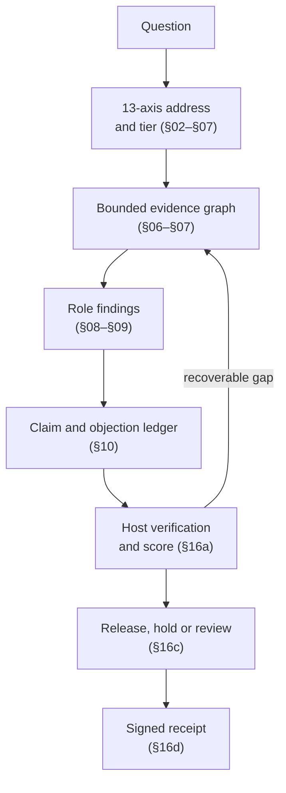
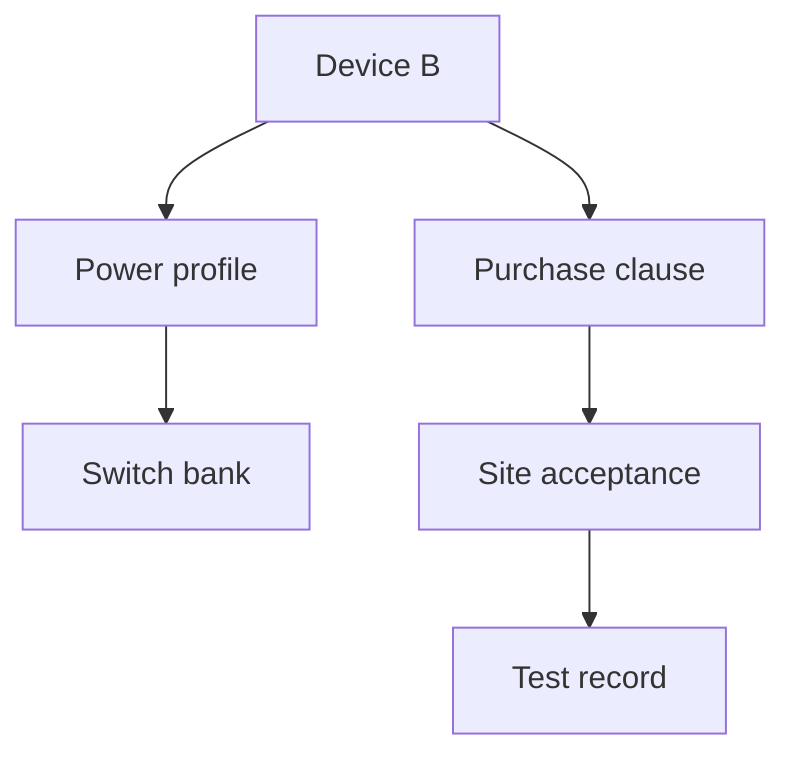
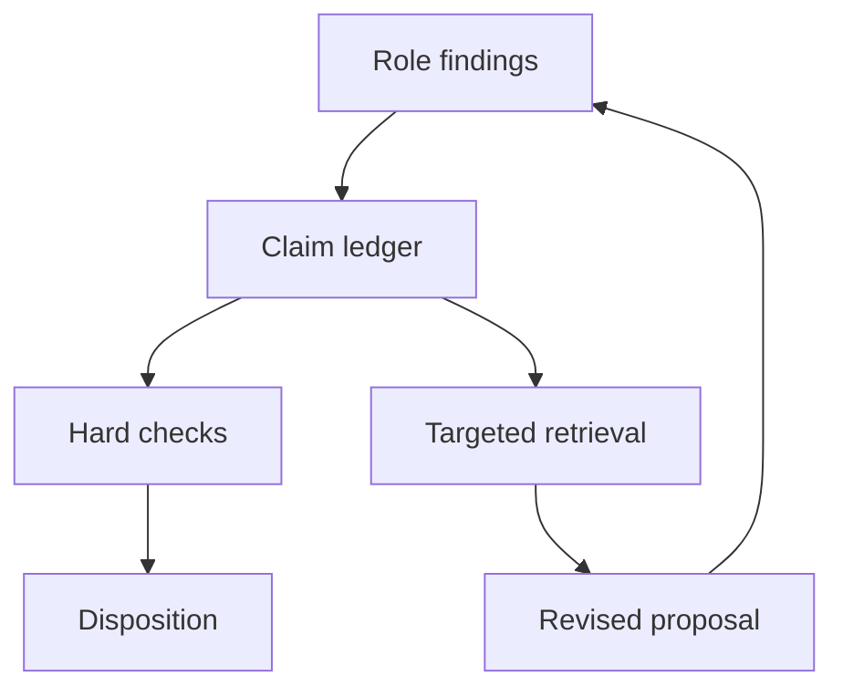

# Universal Knowledge AI (DataLogicEngine)

**A 13-axis control plane for auditable, multi-domain reasoning and governance**

Kevin Herrera · Reference design v3.13 · November 2026

## Abstract

A knowledge address can bring a wireless test, a purchase clause and a site inventory into the same decision. This paper specifies how a host resolves such addresses, retrieves evidence, asks four role-specific questions and reconciles their answers. It defines the conditions for a verified release, a hold or a request for human review. Three worked cases and versioned project registers make the design inspectable. The release rule carries a finite-sample bound on accepted error that holds for any scoring function under stated assumptions. A fixture pilot exercises the control flow. Answer quality has not yet been measured, and the paper states four hypotheses, the study that would test them and the results that would refute them.

## Table of contents

- [00 · Summary](#section-00)
- [01 · The question the control plane answers](#section-01)
- [01b · Related approaches and scope](#section-01b)
- [02 · What a 13-point address identifies](#section-02)
- [03 · Thirteen axes, one working question](#section-03)
- [04 · Sectors, stock numbers and metadata tags](#section-04)
- [04b · A complete address for a single question](#section-04b)
- [05 · How Axis 3 connects two records](#section-05)
- [06 · The spine and the disposable working graph](#section-06)
- [07 · Routing, hydration and the context budget](#section-07)
- [08 · Building the four persona profiles](#section-08)
- [09 · How each persona answers](#section-09)
- [10 · Reconciling four answers](#section-10)
- [11 · The ten-layer simulation stack](#section-11)
- [12 · The twelve-step refinement workflow](#section-12)
- [12b · Call and token bounds per tier](#section-12b)
- [13 · Worked case A · warehouse substitution](#section-13)
- [14 · Worked case B · 200 MWh storage procurement](#section-14)
- [15 · Worked case C · defense-healthcare renewal](#section-15)
- [16a · Verification and the terminal score](#section-16a)
- [16b · Why the retry rule changes calibration](#section-16b)
- [16c · Drift, release decisions and replay](#section-16c)
- [16d · Audit objects and trust boundaries](#section-16d)
- [16e · Threats and controls](#section-16e)
- [17 · Evaluation that could disprove the design](#section-17)
- [18 · What a conforming pilot must demonstrate](#section-18)
- [18b · Minimum conforming profile](#section-18b)
- [19 · Limitations](#section-19)
- [A · Axis 1 pillar register](#section-a)
- [B · Axis 2 sector register](#section-b)
- [B2 · Worldwide Axis 2 scheme extensions](#section-b2)
- [C · DVSS functions and the KA catalog](#section-c)
- [D · Sources and edition notes](#section-d)
- [E · Edition record and supporting data](#section-e)
- [F · Glossary](#section-f)
- [G · Rule-to-enforcement traceability](#section-g)

<a id="section-00"></a>

## 00 · Summary

**What it is.** DataLogicEngine's 13-axis design is a reference control plane for questions whose answer depends on evidence from different sources and authorities. Engineering data, contract terms and site conditions are typical. The host gives the question a typed 13-axis address and retrieves a bounded evidence graph. Up to four roles examine one proposal: a Scholar, a Practitioner, a Regulator and a Harmonizer. Host code, not the model, checks each material claim against retrieved passages. The host then releases, holds or asks for review under a calibrated rule and seals a signed receipt.

**What it is not.** It is not a chatbot, a legal opinion or a certification. A persona emulates a perspective, and professional accountability stays with an identified human reviewer.

**What this edition shows.**

| Status | Items |
| --- | --- |
| Specified | Address grammar, retrieval bounds, routing, role artifacts, hard gate, calibration rule, drift latch and receipt format |
| Checked | The arithmetic in every worked case, the PageRank error bounds, the calibration example and the sample-size figures in §17 |
| Exercised | Control flow in a 21-test fixture pilot on synthetic inputs (§18) |
| Not yet shown | Answer quality, cost, and calibration on real data. The §17 study has not been run, so hypotheses H1–H4 are untested. |



**Reading guide.** §01–§07 cover addressing and retrieval. §08–§12 cover roles and execution. §13–§15 work three cases. §16a–§16e cover verification, release, receipts and threats. §17–§19 cover evaluation, the pilot and limitations. Appendix F is a glossary, and Appendix G traces each rule to where it is enforced and tested.

<a id="section-01"></a>

## 01 · The question the control plane answers

A procurement engineer asks whether a replacement wireless access point can go into a warehouse. The vendor calls it a drop-in replacement. That description leaves three questions open. Will the radio meet the site requirement? Can the switch supply enough power when every port is occupied? Does the customer's purchase agreement permit substitution? Each has a different evidence source and a different person who could settle it.

DataLogicEngine proposes a way to keep those questions together without letting an answer to one settle the others. The host gives the question an address, retrieves a small evidence graph, assigns role-specific work, checks claims, and releases an answer under a recorded decision rule. A reviewer can follow one sentence back to its evidence and see which issue remained open when the answer was written.

### What “deterministically verified” covers

DVSS stands for Deterministically Verified, Stochastically Synthesized. With identical serialized inputs, policy, numerical execution profile and recorded evidence, the host should reproduce its checks and decision. Live searches, model sampling, changing source documents, timestamps and log receipts are external observations. Replay consumes their recorded values. A learned entailment score remains a prediction even when the model weights are frozen.

| Component | What a reviewer can establish |
| --- | --- |
| Address resolver | The same manifest resolves a token to the same typed record. |
| Synthesis model | A particular model returned a particular draft under recorded settings. |
| Verification host | The supplied evidence, scores, objections and policy produced the recorded disposition. |
| Signed receipt | A holder of the signing key committed to these bytes. The inclusion record matches the verification level of the receipt's anchoring profile (§16d). |

### Status and contribution

This is a proposed reference architecture for the 13-axis DVSS design. Graph metrics, entailment scoring and conformal risk control are established methods. The paper claims four things of its own:

1. **A typed address** that keeps record identity, semantic location and evidence identity separate, with explicit slot states so that a missing value cannot waive a requirement (§02–§04).
2. **A host-held ledger** in which roles propose and only the verifier closes, so that no model output can clear a veto (§09–§10).
3. **A release rule whose calibration survives retries.** The terminal candidate is chosen without reading the cutoff, which is the condition the risk bound needs (§16b).
4. **A falsifiable evaluation design** with stated hypotheses, refutation conditions and the sample sizes they require (§17).

Whether this composition improves decisions at a useful cost is an empirical question that §17 would answer. No deployment performance, real credentials, safety certification or legal opinion is asserted.

<a id="section-01b"></a>

## 01b · Related approaches and scope

The design combines six lines of existing work. It adopts each one's method and changes one thing.

| Line of work | What it establishes | What this design changes |
| --- | --- | --- |
| Retrieval-augmented generation and graph retrieval [13, 14, 2] | Retrieved passages ground generation, and graph structure supports multi-hop retrieval | Anchors diffusion in a typed 13-axis address, bounds the graph after hydration and binds each claim to a dated passage |
| Claim decomposition and entailment-based verification [15, 16] | Long outputs can be split into atomic claims and checked against sources | Runs extraction and scoring in the host with a pinned scorer, and treats a missed claim as a measured failure mode |
| Selective prediction and conformal methods [17, 1, 18, 19] | A system can abstain, and distribution-free calibration can bound its error | Applies conformal risk control to a multi-step pipeline, with a retry policy built so the bound still holds |
| Multi-agent debate [20] | Several model instances can surface disagreement | Replaces free dialogue with structured role artifacts, and keeps veto state in the host ledger, not in model prose |
| LLM-as-judge and self-refinement [21, 22] | A model can grade or revise a draft | No gate depends on the generator's assessment of its own work. Studies of unfaithful stated reasoning [23] are the reason. |
| Transparency logs and signed attestations [24, 8] | Append-only logs make after-the-fact changes detectable | Adds anchoring profiles so that an offline installation states only the assurance it has |

Indirect prompt injection through retrieved content [25] motivates the connector boundary in §07 and the first row of the threat table in §16e.

The closest prior work is conformal factuality [18], which calibrates which sub-claims of a model's output to keep. This design differs in three ways. It calibrates a release decision for a whole answer instead of filtering claims. Its loss is graded by reviewers against a rubric that includes missed violations, not only unsupported claims. And its pipeline retries, which is why §16b fixes the terminal candidate before the cutoff is read.

**Scope.** This paper describes a standalone 13-axis design. Statements here apply only to this design and its attached contracts.

<a id="section-02"></a>

## 02 · What a 13-point address identifies

Think of a record for one access-point model. Its manufacturer part number identifies the model in one catalog. Its engineering tags identify the subjects needed to reason about it. A contract line identifies a particular procurement. The same data sheet can support many decisions. The same 13-axis coordinate can describe several sheets. Keeping record identity, semantic location and evidence identity separate makes all three relationships usable.

### Coordinate algebra

In plain terms, an address is thirteen labeled sets, one per axis. Two addresses combine slot by slot, and one address contains another when every slot does. The formal statement follows.

Let Aₘ be the permitted atoms on axis m. A state K = (x₁,…,x₁₃) belongs to the product of finite-subset lattices, with xₘ a finite subset of Aₘ. Ordering is componentwise inclusion. Join uses union in each slot and meet uses intersection. The empty tuple of sets is the bottom element. Required fields, semantic joins and temporal constraints select a valid subset of states. That subset need not itself be closed under meet and join. The word “point” denotes a typed location in this product. Distance in this paper is defined on graph vertices.

| Identifier | Example | Purpose |
| --- | --- | --- |
| Semantic atom | [PL:1.27.0.0] | Resolves Telecommunications and Signal Processing under the selected pillar manifest. |
| Entity key | catalog/vendor-B/model-7 | Identifies a subject across multiple documents in this example. |
| Evidence key | document revision + hash + passage | Identifies the particular text or measurement used in a claim. |
| Claim key | run-17/claim-03 | Identifies an assertion with a subject, predicate, units, scope and polarity. |

### Nuremberg numbering and the canonical grammar

Nuremberg numbering is the project’s name for an ordered, hierarchical integer path. Permanent tokens contain a namespace, colon, axis number, one or more dot-separated nonnegative decimal path components, and enclosing square brackets. Use one spelling per integer, with zero written as 0. Store axis_id separately from the suffix path. For [PL:1.27.0.0], axis_id = 1 and path = [27,0,0]. Serialized paths sort numerically. A scoped interval is an Axis 13 atom with a start, optional open end and claim scope. Collections normalize by canonical key before hashing. Each slot holds a set of unique atoms. Validation rejects duplicates, and a serialized record must list its atoms in canonical order. One registered concept has one canonical atom. Where a registry lists the same subject under two IDs, record them as an alias pair and resolve to the canonical member (Appendix A).

Temporary nodes receive a fresh node UUID per node and a separate session UUID. Two battery comparison nodes in the same run must have different addresses. A runtime address such as [TMP:5.TMP.<node-uuid>] resolves only in that session's overlay. A durable citation binds the evidence record or a sealed snapshot of it.

<a id="section-03"></a>

## 03 · Thirteen axes, one working question

| Axis | Typed role | Warehouse substitution example |
| --- | --- | --- |
| 1&nbsp;·&nbsp;Pillar | Subject and discipline | PL027 covers telecommunications. PL028 covers supply chain. |
| 2&nbsp;·&nbsp;Sector | Economic activity or product/service classification with scheme and edition | Warehouse operations and the purchased equipment are distinct classification objects. |
| 3&nbsp;·&nbsp;Honeycomb | Lateral relation between named concepts | An access-point power profile depends on a switch port's supply capability. |
| 4&nbsp;·&nbsp;Branch | Hierarchical refinement of a subject | Networking → wireless access → radio deployment. |
| 5&nbsp;·&nbsp;Crossroads | Persistent or session-specific entity or intersection | Candidate B in the north warehouse, on switch group 4. |
| 6&nbsp;·&nbsp;Octopus | One concept fans out to applicable rule sources | “Substitution” leads to a purchase clause and a change-control schedule. |
| 7&nbsp;·&nbsp;Spiderweb | Typed overlap, conflict or dependency among requirements | Substitution evidence and acceptance testing share a sign-off dependency. |
| 8&nbsp;·&nbsp;Scholar | Theoretical evidence and measurement validity | Which RF measurements would support equivalence? |
| 9&nbsp;·&nbsp;Practitioner | Installation, operations and cost | Can every proposed unit operate under the available power budget? |
| 10&nbsp;·&nbsp;Regulator | Authority and rule applicability | Which signed clause gives anyone authority to accept an alternative? |
| 11&nbsp;·&nbsp;Harmonizer | Cross-obligation reconciliation | Would a change approved by procurement still fail acceptance testing? |
| 12&nbsp;·&nbsp;Jurisdiction | Territorial, agency or contract nexus | Record the governing buyer and site scope, or explicitly mark unknown. |
| 13 · Valid time | Per-claim intervals and as-of time | The old schedule and renewal can give different answers. |

The geographic slot can be explicitly unscoped for an engineering comparison. Unknown jurisdiction on a binding question instead creates an open dependency. A slot with no active entries contributes no persona budget.

**How Axes 3–7 divide the work.** Axis 1 stops at the pillar and Axis 2 at the sector. Everything beneath them is Axis 4: a branch path such as [BR:4.1.27.1.1] under a pillar or [BR:4.2.8.493] under a sector, where sector branches reuse NAICS 2022 codes. Branches are generated during a run, at most seven levels deep, and exist as temporary nodes until a governed release promotes them. Axis 5 holds a permanent record or the intersection where a branch path meets an Axis 3 link. Axes 3, 6 and 7 are the only stored crosswalks: an evidence-backed lateral link, a concept hub whose arms name each rule source with its edition, and a mesh of typed relations (equivalent, overlaps, conflicts, depends on, stricter than) among requirements. Only verified crosswalk records can support a binding claim. An active Axis 7 entry activates the Harmonizer, and any binding claim activates the Regulator (§07).

Axes 1 and 13 always carry entries. Axis 12 records specified, unknown or unscoped. Axes 2–11 each record one of four states in the coordinate record:

- **Specified:** the slot has atoms.
- **Empty:** the resolver checked and nothing applies.
- **Unknown:** the value could not be determined.
- **Not applicable:** the slot is outside this question.

Unknown on a slot that a binding claim depends on opens a dependency. A record that omits a slot's state fails validation, so a missing slot cannot quietly waive a requirement. Schema keys keep their earlier names, so axis_11_compliance carries the Harmonizer role.

**Why roles sit in the address.** Axes 1–7 and 12–13 say where a question sits. Axes 8–11 say who must review it. They are kept in the same record so that an address is complete for replay: a reviewer can see from the address alone which role profiles were bound to the question. Role atoms take no part in retrieval or in graph distance.

<a id="section-04"></a>

## 04 · Sectors, stock numbers and metadata tags

The stock-numbering and metadata-tagging design pairs the project’s Nuremberg path with issuer-specific identifiers. Industry codes describe economic activity. Product and Service Codes describe what a buyer acquires. A National Stock Number identifies an item of supply. An organization registered in SAM.gov can have a Unique Entity ID. These identifiers answer different questions. The resolver can join them through documented relationships while preserving the issuing authority, original code and edition. DLA describes the 13-digit NSN as a four-digit supply class plus a nine-digit item identification number. SAM.gov describes its UEI as a 12-character alphanumeric entity identifier. [4–5]

| Namespace | What it identifies | Join example |
| --- | --- | --- |
| NAICS / SIC | Industry under a particular scheme and edition. NAICS 2022 is the Axis 2 authority; SIC 1987 only translates older sources | Organization operates in a sector. |
| PSC | Procurement product or service class | Contract line purchases a class of goods. |
| NSN / manufacturer's part | Item of supply / manufacturer-specific item | A verified catalog cross-reference identifies the item. |
| SAM.gov UEI | Registered entity | Contract names an entity as supplier. |
| Local metadata tag | A source-qualified annotation | Test report describes an item at a site on a date. |

### Keep codes reversible

Store the native code as text. Leading zeros and letters may be meaningful. Mint an integer surrogate only inside an editioned resolver table with a unique key (authority, edition, native_code). Persist the source relation, its effective interval and the evidence for it. Equipment class, vendor and industry alone cannot establish item interchangeability. No lookup of a real item or vendor is asserted here.

### Two historical numbering conventions

The project sector workbook uses 2.sector.scheme.ordinal, where the four local scheme slots read NAICS, PSC, SIC, NIC. The v3.5 paper describes 2.scheme.code with NAICS, SIC, PSC, NIC. A bare 2.3… is ambiguous. A reader or application must supply the registry and edition before resolving it. From the 3.6.0 contracts onward, retain the old address as a qualified alias and expose the native scheme code alongside the resolved entity. From v3.10, Axis 2 registers the 20 NAICS 2022 sectors as SC01–SC20 at coordinates 2.1–2.20, and the scheme slots survive only as crosswalk aliases with a resolution status. Appendix B lists the sectors. Appendix B2 covers the 100 worldwide cross-references recorded under scheme slots 5–9.

<a id="section-04b"></a>

## 04b · A complete address for a single question

The following manifest illustrates the warehouse question. Only the PL027 and sector 8 roots refer to the project workbook. Other local IDs and dates are fixture values. A production resolver must verify each referenced row in its own manifest. Axis 13 stores interval objects directly. Displaying their short names here keeps the tuple readable.

| Slot | Atoms or interval | Decoded meaning |
| --- | --- | --- |
| x₁ | [PL:1.27.0.0], [PL:1.28.0.0] | Telecommunications and supply chain. |
| x₂ | [SECTOR:2.8] | Workbook sector 8, Transportation and Warehousing. |
| x₃ | [LINK:3.17] | Device power requirement links to supply capacity. |
| x₄ | [BR:4.1.27.1.1] | Access point deployment, a branch under PL027. |
| x₅ | [NODE:5.41], [NODE:5.42] | Two distinct records for candidates A and B. |
| x₆ | [HUB:6.7] | Substitution authority cross-references contract terms. |
| x₇ | [MESH:7.9] | Change approval and site acceptance obligations. |
| x₈, x₉ | [ROLE:8.2], [ROLE:9.4] | RF Scholar and deployment Practitioner. |
| x₁₀, x₁₁ | [ROLE:10.3], [ROLE:11.5] | Contract reviewer and acceptance reviewer. |
| x₁₂ | [JUR:12.1] | United States, California, north warehouse site; legal nexus: the buyer and the site owner. |
| x₁₃ | scope=renewal, start=2026-01-01, end=2027-01-01 | The validity interval includes the start date and excludes the end date. |

### From this address to an answer

Decode the tuple into the role packets. For the Practitioner, join B to its stated full-profile demand, follow LINK:3.17 to the inventory, and retrieve the bank limit. For the contract reviewer, traverse HUB:6.7 to the applicable authorization clause. The new proposal joins the two results only at the final decision. A shared coordinate or a shared path creates a retrieval opportunity. Support for a specific sentence comes from a dated passage or a recorded calculation over those passages.

### What the tags contribute

Store evidence tags such as source class, applied units, issue date, revision, permitted use and claim scope alongside the node. Preserve the original native stock or entity identifier. Tags constrain comparison, retrieval and citation, which lets another model use the same address once its resolver and readable packet are supplied.

<a id="section-05"></a>

## 05 · How Axis 3 connects two records

Reachability answers “can I get there?” A crosswalk answers “why should I go there?” A connected taxonomy gives every pair of permanent vertices a path through the root. Most of those paths are too general to justify an inference. An Axis 3 record names a useful lateral relation and the evidence for it. A reviewer can traverse either direction for discovery and still read the original direction of the predicate.



### A typed edge carries an argument

Store (edge_id, subject, predicate, object, provenance, scope, valid_from, valid_to, cost). For example, “B requires up to 28 W under profile P” can be joined to “ports in bank 4 supply 30 W under configuration C.” Traverse from either endpoint. To infer feasibility, the host must align profiles and units, inspect aggregate power and attach the source passages to the resulting claim. A third record about mounting compatibility requires a separate edge.

### What an address can elicit from a model

The host resolves the address into readable labels, scope, predicates and evidence. That context can cue a model's learned associations and help it formulate a useful question. A model receiving a previously unseen opaque ID has no contractual way to locate a matching training document in its weights. An answer based solely on learned associations remains a hypothesis. A citation requires a retrieved passage or an authorized user-supplied exhibit. Test the incremental value of labels, paths and evidence separately in §17.

<a id="section-06"></a>

## 06 · The spine and the disposable working graph

The Universal Knowledge Graph (UKG) holds versioned concept identities, hierarchy, crosswalk templates and resolver tables. A read-only snapshot can serve many sessions. The Universal Simulated Knowledge Database (USKD) is a session overlay holding selected vertices, typed edges, generated hypotheses and evidence pointers. A new relationship discovered during a session may become a proposal for a later governed update. A release can never promote it to the shared spine implicitly.

### Geodesic and traversal

Distance counts the costed steps between two concepts. Moving up and down the hierarchy always works, and a lateral link can make the trip shorter. The definitions below make that precise.

Let G = (V,E,c) be finite and undirected for traversal, with positive costs and at least two vertices. Its tree edges span every vertex from a virtual root. Verify connectedness and acyclicity and derive one oriented parent for each non-root. The cheapest path length d(i,j) = min over paths P of ∑ c(e), summing over edges e in P, is a metric. Positivity separates vertices, path reversal gives symmetry, and concatenation followed by cycle removal gives the triangle inequality. On the unit tree, distance equals depth(i) + depth(j) − 2 depth(LCA(i,j)). A bridge can shorten this distance.

### Personalized PageRank

Personalized PageRank spreads weight outward from the question's anchors. Concepts that are close to the anchors and strongly linked to them collect the most weight. The bound below says when the spreading has settled closely enough to stop.

Use edge affinity aᵢⱼ = 1/cᵢⱼ on present edges and zero elsewhere. For parallel relations specify aggregation, here sum. This makes cheap traversal correspond to strong diffusion. Set Dⱼⱼ = Σᵢ aᵢⱼ and W = A D⁻¹. A nonempty seed set gives a probability vector s, uniform by default. Initialize r₀ = s and iterate rₖ₊₁ = 0.15s + 0.85Wrₖ. A seedless query returns insufficient grounding and the single-root case returns its unit mass directly.

Because W is column stochastic, the L₁ contraction factor is 0.85. After 80 iterations the fixed-point error is at most 2 × 0.85⁸⁰ ≈ 4.51 × 10⁻⁶. Stopping when successive vectors differ by at most 1.76 × 10⁻⁶ gives error at most 0.85/0.15 times that change, which is below 10⁻⁵. These are numerical guarantees on diffusion. Whether a high-scoring provision applies is a separate evidence question. Graph retrieval in HippoRAG provides a relevant empirical baseline. [2]

The virtual root needs care. It touches every pillar, so weight that reaches it spreads to unrelated subjects. Exclude the root from diffusion, or give its edges a cost high enough that lateral and branch edges dominate. Report which choice a build makes, because it changes what is retrieved. The root still counts for connectivity and for tree distance.

### A bound that survives hydration

PPR costs O(|V| + |E|) per iteration for a sparse spine. Filter by access, scope, hop count and a configured minimum score. Sort by descending score with stable record-ID tie-breaking. Reserve slots for newly synthesized nodes, then enforce 250 total retained vertices, four hops, per-passage text limits and an explicit edge and token budget after hydration. Start with one hop for Tier 1 and two for Tiers 2–3, adding one per authorized retry up to four. An uncapped edge list between 250 vertices can dominate prompt size. Repeat all limits after expansion.

### Adding a subject area

The spine grows only through governed releases, never from inside a session. Adding a subject takes five steps:

1. Register each new ID with a source-qualified name, an owner and its members. An ID without them cannot be used. Only the top-level pillar needs registering: members beneath it are resolved at query time as Axis 4 branches, to whatever depth the question needs, so the registered members are seeds, not a closed list.
2. Give every new vertex one parent edge, so the tree stays connected and acyclic. Check that the new subject does not duplicate an existing one (Appendix A).
3. Add Axis 3, 6 and 7 crosswalk templates only with evidence for each relation, and record any external code with its authority and edition (§04).
4. Publish a new registry version and manifest digest.
5. Rerun the §18 fixtures against the new manifest.

The main cost is calibration, not data entry. A new domain changes the mix of questions, and a registry change that invalidates calibration latches the drift alarm (§16c). Certified release resumes only with an approved calibration artifact, which needs adjudicated calibration queries that include the new domain. Until those exist, questions in the new domain can run under the advisory profile or return holds.

<a id="section-07"></a>

## 07 · Routing, hydration and the context budget

The proposed reference rubric scores topic count D, regulatory exposure R and ambiguity M separately from 0 to 3. D bands are one, two, three-to-four, and five-or-more pillars. R bands are none, voluntary guidance, a binding framework, and cross-framework conflict. M bands are lookup, comparison, conditional or multi-period decision, and open counterfactual. Derive S = D + R + M. Store the feature values and evidence behind each classification.

Let B = 1 when intake detects a binding predicate, or when R is 2 or 3. A question scored as exposed to a binding framework is a binding question even when no predicate was matched. Let Z = 1 when the query's maximum cosine similarity to a curated failure centroid meets a threshold, using a pinned embedding model. Build the failure centroids and set that threshold from development data only. Held-out challenge queries never feed them (§17), so the router's measured recall is not inflated. The effective score is S_eff = max(S, 3B, 6Z).

| Tier | S_eff | Roles |
| --- | --- | --- |
| 1 | 0–2 | Scholar |
| 2 | 3–5 | Scholar and Practitioner |
| 3 | 6–9 | All four roles when B = 1 or Z = 1. High-complexity work with B = 0 and Z = 0 keeps the Tier 3 budget but activates only the relevant roles. |

A Z hit always reaches Tier 3 with all four roles. A question that resembles a known failure gets the full review even when it reads as a simple lookup.

Any binding claim activates the Regulator at whatever tier the run uses. That holds whether B came from intake or the claim first appears in a draft. When the claim draws on more than one obligation source, shown by an active Axis 7 entry, the Harmonizer joins as well.

A binding claim can first appear in a draft whose roles lack the Regulator, at Tier 1 or at Tier 2. That triggers the run's single escalation. The run continues at the tier S_eff gives when recomputed with B = 1, which is at least Tier 2, with the Regulator active. Every objection raised so far carries forward, and the escalation does not count as a retry. Tier 1 has no authority to issue binding approval. Detection can still miss a binding assertion. §17 measures that miss rate.

### Evidence acquisition and time

Both early hydration and the later binding-claim check call one controlled connector interface. Log separate call purposes. For each passage preserve source class, revision, content digest, exact locator, retrieval time, applicable interval, authority, access scope and permission to retain or replay. A derived node remains a hypothesis. Its individual supported assertions can cite attached evidence. When an important source is unavailable, the corresponding obligation remains open.

Use half-open valid-time intervals [start,end) with open end represented by null. Two intervals overlap when each begins before the other's end. Convert a supplied inclusive last date to an exclusive end once on ingest. Evaluate each historical and prospective scope independently. A clause superseded today can still govern a past interval. Missing jurisdiction or conflicted precedence creates a review item for a binding claim.

**The Axis 13 record.** Each interval records what it is about, its claim scope and one of three kinds: effective (a rule, contract or edition is in force), applicability (an obligation reaches a scope) or observation (a fact was true from a time). Dates are civil dates read in a named time zone, taken from the Axis 12 place when the source gives none; instants are UTC. One interval never mixes the two. The record keeps the source wording, whether the source's last date was inclusive, and any legacy form it was converted from, such as a quarter code or a 9999-12-31 open end. Versions of one subject chain through supersedes and superseded-by links: a successor starts exactly where its predecessor ends, and versions never overlap. A valid time that cannot be determined is recorded as unknown, never guessed, and on a binding claim it opens a dependency. Each record also carries the time the system learned it, separate from valid time, so a replay can ask what was known at one time about another. The coordinate carries only the date projection of each interval; finer precision stays in the record and its evidence.

### Packing

Reserve space for system rules, selected graph evidence, structured artifacts, model-reserved reasoning capacity where supported, and output. Compute each role's mass over its active retained neighborhood. Allocate artifact tokens proportional to these masses. If their sum is zero, divide equally among active roles. Use largest-remainder rounding with a stable role-ID tie-break. Recompute after graph expansion. Protect minimum evidence and output space before adding lower-ranked context. Record truncations and tokenizer/version for replay.

<a id="section-08"></a>

## 08 · Building the four persona profiles

The Multi-Domain Knowledge Framework (MDKF) supplies a seven-part role template. A persona is a role specification for the synthesis model. A degree in a profile describes the perspective to emulate. Professional accountability belongs to an identified human reviewer when the policy requires one. For each role store a version, mandate, admissible evidence, prohibited decisions, visibility policy and a seven-field profile.

**Where each profile comes from.** A profile is built for the question, not picked from a fixed list. The Scholar is built from the Axis 1 pillars and Axis 4 branches, the Practitioner from the Axis 2 sector and its branches, the Regulator from the Axis 6 hub arms, and the Harmonizer from the Axis 7 meshes. The Regulator and Harmonizer also read Axis 12, which is resolved first. Each of the seven fields is drafted from those inputs alone and records which atoms it came from. Education is checked against CIP 2020 codes, job roles and related jobs against the CIP-to-SOC crosswalk and O*NET occupations, and the Regulator's and Harmonizer's credentials must trace to a hub arm or a mesh. A field that cannot be traced is dropped, and a credential that no source names becomes a competency tag rather than an invented certification. Traits, guardrails and vetoes are not profile fields: they are fixed conduct for each role, stored with the role, so the same rules apply whatever profile is built. Profiles never carry a human name or claimed personal credentials.

**Axis 12.** A jurisdiction record holds an ISO 3166 place, such as US and US-CA, and a separate list of legal nexus entries (a federal or state agency, a contract, the buyer, the site owner), each with the basis for applying it. Its state is specified, unknown or unscoped. The Regulator and Harmonizer may apply only rule sources whose jurisdiction matches the record and whose Axis 13 interval covers the as-of date. Jurisdiction is never inferred from the user's own location.

The tables below give illustrative profiles for the warehouse case.

| Profile field | Axis 8 · Scholar | Axis 9 · Practitioner |
| --- | --- | --- |
| Job role | Wireless systems researcher | Distribution-site network engineer |
| Formal education | Radio engineering and propagation | Network engineering or equivalent field preparation |
| Certifications | Measurement-method competency tag | Vendor switching and wireless track |
| Technical skills | Link budgets, antennas, uncertainty | PoE budgeting, controller and mount compatibility |
| Job training | Repeatable RF measurement protocols | Occupied-site cutovers and rollback drills |
| Career path | RF lab to applied validation | Field installer to deployment lead |
| Related jobs | Test engineer, statistician | Warehouse IT, cabling lead, shift supervisor |

| Profile field | Axis 10 · Regulator | Axis 11 · Harmonizer |
| --- | --- | --- |
| Job role | Contract authority analyst | Acceptance and change-control reviewer |
| Formal education | Contract interpretation | Systems assurance and quality engineering |
| Certifications | Contract-management competency tag | Quality and change-control competency tags |
| Technical skills | Clause version, delegation and scope | Traceability, interface requirements, test evidence |
| Job training | Review of amendments and delegations | Acceptance planning and dependency review |
| Career path | Procurement analyst to policy reviewer | Test lead to assurance reviewer |
| Related jobs | Buyer, contracting officer, counsel | Site owner, safety lead, configuration manager |

### Selecting a profile

For a proposed scoring rule, E = min(1, degree/required_degree) × exp(−γd), where d is graph distance between disciplines and γ is a development-set constant. C is the fraction of required credentials represented. X is min(1, years/required_years) times a sector-lineage match in [0,1]. Omit inapplicable terms and renormalize their weights. Missing evidence for an applicable term scores zero. Default weights give M = 0.25E + 0.45C + 0.30X. For E = 1, C = 0.5 and X = 0.8, M = 0.715. Mandatory qualifications are eligibility filters applied first. Persist the winning profile and stable tie-break.

<a id="section-09"></a>

## 09 · How each persona answers

Each role receives the user's question, its mandate, a role-filtered evidence packet and the same candidate proposal ID. The Scholar gets the survey and method. The Practitioner gets device specifications, switch inventory and operating constraints. The Regulator gets the signed terms and their scope. The Harmonizer gets the acceptance schedule and cross-references. They all need to distinguish an absent document from a document that says a condition has been satisfied.

| Role | Question and scoped finding | What the host records |
| --- | --- | --- |
| Scholar | “Was B tested in the installed aisle geometry?” The lab sheet uses a different antenna position. Coverage equivalence remains open. | Claim S1, lab passage, missing aisle survey, affected proposal B. |
| Practitioner | “Can the fully populated bank power B?” Twelve units at 28 W draw 336 W against a 300 W allocation. | Claim P1, units and arithmetic, source revisions, proposed split across banks. |
| Regulator | “Who may approve a substitute?” The example clause requires a signed change by the named buyer. No signed change is in the packet. | Objection R1, clause locator, scope, requested sign-off, unresolved state. |
| Harmonizer | “Would a signed change also establish site acceptance?” A separate schedule requires the acceptance test after configuration. | Objection H1, schedule locator, independent acceptance dependency. |

### Minimal evidence-bearing artifact

A role returns its profile ID and axis, proposal version, scoped claims, claim-to-passage references, assumptions, disconfirming observations, and objection records. An objection contains an ID, owner, severity, scope, predicate required for closure and evidence references. The host assigns the profile score and validates IDs and references against the packet. A role can propose closure. The verifier records its own closure decision and the evidence it observed.

The abbreviated Regulator record below carries objection R1 from the warehouse case. Its objection fields match the receipt contract. The blocking flag expresses severity, the role axis identifies the owner, and the objection takes the scope of the claim it rests on.

```json
{
  "profile_id": "reg-contract-authority/v3",
  "role_axis": 10,
  "proposal_id": "B/1",
  "claims": [
    {
      "claim_id": "R1-c1",
      "assertion": "A substitute requires a change signed by the named buyer.",
      "binding": true,
      "scope": "renewal",
      "passage_ids": ["E3#clause-7.2"]
    }
  ],
  "assumptions": ["E3 is the governing purchase schedule for the renewal scope."],
  "disconfirming_observations": ["No signed change appears in the packet."],
  "objections": [
    {
      "objection_id": "R1",
      "role_axis": 10,
      "proposal_id": "B/1",
      "blocking": true,
      "predicate": "A change signed by the named buyer and covering candidate B is in evidence.",
      "state": "open",
      "closure_evidence": []
    }
  ]
}
```

R1 stays open on the revised proposal B/2, because E5 changes the power layout but supplies no signed change. Only the verifier can set its state to closed, and only by citing a passage that satisfies the predicate.

In blinded mode the two assurance roles receive the proposed operation, relevant evidence and the question before seeing the advocates' arguments. Preserve call boundaries and packet digests. Shared training and shared sources can still induce correlated errors. A four-role agreement supplies no independent vote count or automatic confidence increment.

### Example artifact in plain language

“P1 applies to bank 4 under profile P. Twelve units require 336 W at the stated maximum. The provided bank budget is 300 W. Do not approve twelve on this bank. Revisit if a revised cable and bank assignment is supplied.” This is inspectable work product. The model's private reasoning is unnecessary for reviewing the arithmetic.

<a id="section-10"></a>

## 10 · Reconciling four answers

Normalize claims before combining them. Two sentences can appear to conflict because they address different devices, periods or meanings of “approved.” A structured claim uses (subject, predicate, object, units, scope, interval, evidence). Group matching predicates only after entity, unit and time normalization. A positive and negative assertion about the same normalized claim require adjudication.

| Conflict class | Example | Resolution |
| --- | --- | --- |
| Scope mismatch | Lab success versus coverage in aisle 7 | Retain both scopes. Ask for the site measurement. |
| Factual contradiction | Two power sheets for the same revision | Resolve revision and test profile. Preserve both if unresolved. |
| Binding veto | Substitute lacks required buyer authorization | Suppress affirmative authorization. Require the signed change or authorized review. |
| Objective trade-off | Two compliant designs differ on cost and downtime | Report the nondominated options with values and assumptions. |
| Evidence gap | Missing renewal schedule | Record unknown, retrieve within policy, then defer if unresolved. |



An option dominates another only when it is at least as good on every specified objective and better on one. Compare on compatible units and after feasibility checks. If one option is cheaper and another reduces outage time, both can remain on the frontier. The final writer produces one scoped answer with a disposition, reasons, conditions, alternatives and evidence IDs. It cannot turn an unresolved veto into approval or silently delete the minority finding.

“Deep recursive learning” here means bounded inference-time refinement. On a retry, the host carries forward the objection ledger, expands the evidence neighborhood, updates the affected roles and verifies a new candidate version. Model weights and canonical registries change only through separately governed offline work. Each retry must state which uncertainty it can plausibly resolve.

<a id="section-11"></a>

## 11 · The ten-layer simulation stack

FROST is the project's name for this ten-layer stack. The stack defines responsibility, and the twelve steps in §12 define execution order. A layer can run more than once and a step can use more than one layer. This is a coverage relation. One-to-many associations are represented explicitly. Early scope filtering limits what the generator sees. Late filtering checks the actual claims it produced.

| Layer and owner | Input → operation → durable review artifact |
| --- | --- |
| 1 · Grounding / host | Normalize query and proposed anchors. Resolve/validate tokens, record uncertain matches, tier and active-axis mask. Model-proposed labels remain candidates until validated. |
| 2 · Graph / host | Select the scoped spine neighborhood, add session hypotheses and hydrate through controlled connectors. Record manifest, source versions and selected edges. |
| 3 · Profiles / host | Match eligible MDKF profiles, allocate role budgets and seal the inputs visible to each role. |
| 4 · Perspectives / model | Produce role-local findings plus relevant stakeholder constraints. Record which role saw which packet. |
| 5 · Arbitration / host and model | Merge normalized claims and open objections. The host enforces veto state and option comparability. |
| 6 · Alignment / host and model | Reconcile terminology, provenance and conflicts across crosswalks. Preserve unresolved interpretations and propagation scope. |
| 7 · Scope / host | Re-evaluate jurisdiction and effective intervals on each issued claim. Record applicability or the missing premise. |
| 8 · Verification / host and scorer | Independently extract claims, verify binding sources, apply pinned entailment model and score candidate. |
| 9 · Refinement and release / host | Decide structural retry before consulting the final calibrated cutoff. Evaluate terminal hard checks, risk and drift. |
| 10 · Receipt / host | Hash returned bytes, sign, anchor, persist limited evidence references and release or hold. Purge session data under retention policy. |

### State shared between layers

A run carries one snapshot ID, a query-scope object, graph revision, ordered attempt list, role packet manifests, claim and objection ledgers, candidate versions and policy digest. A new attempt appends state. It never overwrites the evidence or veto history of an earlier attempt. Every material claim in the final prose points to its latest verified claim record.

<a id="section-12"></a>

## 12 · The twelve-step refinement workflow

| Step | Layers | Action in the warehouse example |
| --- | --- | --- |
| 1&nbsp;·&nbsp;Ingest | 1 | Capture the original question and normalize candidate device identifiers. |
| 2&nbsp;·&nbsp;Anchor | 1 | Resolve sector, telecom pillar, site and current purchase schedule. Persist ambiguous aliases. |
| 3&nbsp;·&nbsp;Screen | 2 | Reject unknown catalog aliases as factual anchors. Tag a proposed substitution as a hypothesis. |
| 4&nbsp;·&nbsp;Retrieve | 2, 7 | Diffuse from anchors, apply access/time limits, hydrate device, inventory and contract records. |
| 5&nbsp;·&nbsp;Deliberate | 3–4 | Select profiles for the tier's roles, plus the Regulator for any binding claim. Each role returns claims against the same proposal ID. |
| 6&nbsp;·&nbsp;Reconcile | 5 | Align claims, identify the power deficit, open authority and acceptance objections. |
| 7&nbsp;·&nbsp;Crosswalk | 6 | Join the device to its port profile, and the purchase clause to the acceptance schedule. |
| 8&nbsp;·&nbsp;Scope | 7 | Resolve bank, site and contract era. Track an outdated schedule separately. |
| 9 · Verify authority | 8 | For binding claims retrieve applicable authoritative text and any evidence of incorporation. |
| 10&nbsp;·&nbsp;Score | 8 | Extract atomic claims, score support, compute freshness and record missing evidence. |
| 11 · Refine and decide | 9 | Retry if a fixable evidence gap and authorized source remain. Select terminal candidate, then apply the release rule once. |
| 12&nbsp;·&nbsp;Seal | 10 | Bind the actual response and attempt digests. Verify signing/anchor status before issuing a verified receipt. |

### What happens on a second pass

A warehouse planner supplies a revised bank assignment already available to the authorized connector. The first pass recorded P1 against proposal B/1. Step 11 expands the neighborhood and re-enters step 4. Roles see proposal B/2 and the changed evidence, with unresolved R1 and H1 carried forward. The power claim can clear while approval and acceptance remain open. Step 12 commits both the terminal disposition and references to the first pass.

Model calls are bounded by tier, blinded-mode fan-out and the retry limit. Escalation is a separate, one-time event and is logged even when it precedes retry 1. The receipt distinguishes attempted retrieval, successful retrieval and a verified claim.

<a id="section-12b"></a>

## 12b · Call and token bounds per tier

The retry policy in §16b allows an initial attempt and at most two retries, plus the single escalation described in §07. A run therefore has at most four attempts, matching the receipt contract.

The bounds below assume each attempt makes one call per active role, one writer call and one claim-extraction pass. Blinded mode changes what the assurance roles see, not how many calls they make. A policy that adds a second blinded pass must add it to these counts.

| Run | Roles per attempt | Attempts | Role calls | Writer calls | Extraction passes | Model-side calls |
| --- | --- | --- | --- | --- | --- | --- |
| Tier 1 | 1 | ≤ 3 | ≤ 3 | ≤ 3 | ≤ 3 | ≤ 9 |
| Tier 2 | 2 | ≤ 3 | ≤ 6 | ≤ 3 | ≤ 3 | ≤ 12 |
| Tier 2 with Regulator | 3 | ≤ 3 | ≤ 9 | ≤ 3 | ≤ 3 | ≤ 15 |
| Tier 3, or Tier 2 with Regulator and Harmonizer | 4 | ≤ 3 | ≤ 12 | ≤ 3 | ≤ 3 | ≤ 18 |
| Tier 1 draft escalated to a four-role run | 1, then 4 | ≤ 4 | ≤ 13 | ≤ 4 | ≤ 4 | ≤ 21 |
| Tier 2 draft without the Regulator, escalated to a four-role run | 2, then 4 | ≤ 4 | ≤ 14 | ≤ 4 | ≤ 4 | ≤ 22 |

The entailment scorer runs once per claim and evidence bundle in each attempt. Connector traffic per attempt is one hydration request set plus one authority check per binding claim. A repeated identical request reuses its idempotency key and its recorded result. Every call is bounded by the packing limits in §06 and §07, so a run's token cost is at most its call count times the per-call budget. These are policy bounds, not measurements. The pilot should log actual counts, and §17 reports latency, tokens and cost.

<a id="section-13"></a>

## 13 · Worked case A · warehouse substitution

All item labels, powers, terms and test conditions on this page are constructed fixtures. The commercial decision is whether a buyer can authorize candidate B for deployment. The facts needed for a radio design, a site installation and a contract change are deliberately split across exhibits.

| Exhibit | Supplied fact |
| --- | --- |
| E1 · Device sheet | B uses up to 28 W under the intended radio profile. |
| E2 · Inventory | Bank 4 provides a 300 W budget for the relevant ports. |
| E3 · Purchase schedule | A substitute requires an authorized buyer's signed change. |
| E4 · Acceptance schedule | The installed configuration requires a site survey and sign-off. |
| E5 · Revised assignment | A second available bank permits six units on each bank, with 300 W available on each. |

### Initial and revised answers

Pass 0 retrieves E1–E4. Twelve units on one bank require 336 W, exceeding its allocation by 36 W. The arithmetic check settles this specific power question. The Scholar finds no aisle survey. The contract analyst finds no authorization. The assurance reviewer distinguishes permission to purchase from final site acceptance.

Pass 1 adds E5 and revises the proposal. Six units per bank require 168 W per bank, leaving 132 W of the stated available budget on each. This closes the aggregate-power objection under E5's stated availability. It does not establish per-port compatibility, coverage, mount fit, redundancy margins or approval. No additional authorized source in the fixture can settle the missing documents. The host stops.

### Single answer the user receives

“Hold the substitution for buyer review. The revised six-and-six layout fits the stated aggregate power budgets. Confirm per-port capacity and test coverage in the installed aisle geometry. The purchase schedule requires a signed substitution, and the acceptance schedule separately requires the site sign-off. Neither approval appears in the supplied records. Evidence E1–E5.”

The outcome is a withheld affirmative approval with a human-readable explanation. A system scoring this as an ordinary accepted recommendation would overstate coverage. An auditor can replay the two arithmetic checks without trusting the language model.

<a id="section-14"></a>

## 14 · Worked case B · 200 MWh storage procurement

A utility asks whether to buy solid-state lithium-metal or sodium-ion storage for 2027. Chemistry, supply chain, cycle life and operating cost are relevant. The base scenario requests a trade study and names no binding mandate. Two roles suffice for the proposed Tier 2 route. A draft that asserts a design satisfies a safety requirement has made a binding claim. The Regulator then joins the run, and the assertion goes through the applicable binding checks.

### Address and evidence packet

Anchor energy systems in PL023 and the utilities sector in the workbook, then add two temporary comparison nodes. Each has its own node UUID. Attach a dispatch model, an independently identified performance test, project cost assumptions and the validity dates of any supplier offers. These are illustrative evidence types. No measurements or offers for either chemistry were obtained for this case.

### Make the comparison falsifiable

A useful comparison fixes system boundary and duty cycle. For a simple battery-side example, one full equivalent cycle per day at 200 MWh for 365 days gives 73,000 MWh nominal annual discharge before availability and degradation adjustments. At 90% of nominal annual discharge the denominator becomes 65,700 MWh. Model end-of-life capacity, outages and charging costs consistently. Energy capacity alone does not specify power or duration.

LCOS = discounted lifetime cost / discounted delivered energy. A scenario costing 9.0 million monetary units in present value for 100,000 discounted MWh yields 90 per MWh. A second at 8.4 million for 80,000 yields 105. Those invented scenarios illustrate how a cheaper installed system can have a higher delivered-energy cost. They do not identify either chemistry.

### Reconciled answer

The Scholar checks comparability of cycle tests and uncertainty around translating them to the proposed duty cycle. The Practitioner asks for site-ready capital cost, delivery terms, service obligations and replacement assumptions. The final answer gives a comparison under declared scenarios, names the missing bid inputs and leaves the chemistry ranking open. If complete offers later produce nondominated cost and lifetime options, report both. A manufacturer adjective such as “safer” needs a defined metric and comparable test conditions.

<a id="section-15"></a>

## 15 · Worked case C · defense-healthcare renewal

A U.S. defense contractor asks whether patient scans held under a 2024 clinical research contract can move to a commercial multi-tenant cloud service for a 2026 renewal. This fictional exercise asks which evidence could settle the decision. It provides no patient data, contract, authorization package, legal clearance or statutory applicability determination.

| Stage | Evidence or action |
| --- | --- |
| Ground | Assign separate base-contract and renewal scopes. Anchor medicine, cloud systems and the federal acquisition namespace. Identify which entity proposes to move what data to which provider. |
| Retrieve | Collect actual awards, amendments, incorporated clauses, data classification, system boundary and the provider's authorization status. A crosswalk can suggest DFARS clauses, health-data rules or cloud authorization requirements for review. |
| Deliberate | Scholar identifies clinical processing purpose. Practitioner maps tenancy, processor and subprocessor locations. Regulator requests operative contract text. Harmonizer compares data-handling, retention and authorization conditions. |
| Reconcile | Separate the original workload, proposed change and a possible dedicated or government-cloud alternative. That alternative would still need the other independently applicable controls. |
| Verify | Bind each material conclusion to dated source text, exact facts and scope. An official rule found in search does not itself establish incorporation, jurisdiction or authorization. |
| Release | Missing controlling facts yield a hold or a conditional explanation. A reviewer may authorize a revised proposal only with versioned evidence clearing every applicable objection. |

### Sample final response

“Approval is pending. Establish which renewal terms govern, classify the scans for this workload, document the cloud and subprocessor boundary, and obtain the applicable cloud authorization and data-handling analysis. The 2024 approval record, if one exists, must be evaluated within its original scope. A dedicated or government-cloud configuration is an alternative for review. Its tenancy alone cannot settle clinical, security or contractual acceptance.”

Clinical examples stay outside model prompts unless the processing environment and permissions cover them. The demonstration can run entirely on invented documents. Where an agency has its own mandatory reviewer, encode that authority as a release condition and preserve the review record in the receipt.

<a id="section-16a"></a>

## 16a · Verification and the terminal score

The claim extractor sees the whole draft plus role artifacts. It assigns stable claim IDs, separates compound statements and flags binding statements about permission, obligation or safety. A frozen natural-language inference model scores each claim against permitted passages. Train or tune any score transformation away from the final calibration set. Version the model, tokenizer, passage segmentation and aggregation. Report claim-extraction recall separately because a missed claim cannot be rescued by an excellent entailment score.

| Verified source class | Default p | Use |
| --- | --- | --- |
| Enacted or controlling primary text | 1.00 | Binding when applicable to the facts, jurisdiction and date. |
| Binding standard or executed instrument | 0.95 | Identify incorporation, authorization or the other source of binding force. |
| Peer-reviewed technical evidence | 0.85 | Scientific support within the measured domain. |
| Industry practice or vendor description | 0.70 | Scoped descriptive evidence with limitations. |
| Unhydrated synthesis | 0.40 | Hypothesis only. |

For claim i, let eᵢ be its entailment score and zᵢ = pᵢeᵢ. Define bᵢ = pᵢ I[active in the claim's scope] exp(−λᵢ ageᵢ), with age measured in years relative to that scope. Example policy rates are 0, 0.01 and 0.05 per year for stable mathematical facts, technical sources and frequently amended text. Age influences a heuristic score. An old rule can still be legally operative. Evidence applicability is a separately verified condition.

### Hard gate and score

H requires valid schema and scope, a nonempty assessable claim set, completed applicable authority checks for every binding claim, and zero unresolved blocking objections. Document class alone cannot satisfy H. Use one supported, applicable evidence bundle per claim under a fixed selection policy. Conflicting material evidence remains in the objection ledger.

Let J be the binding claims, or all claims if there are no binding claims. Let d be the fraction of unique objections unresolved, zero when none were raised. A concrete score is u = 0.40(1 − minⱼ zⱼ) + 0.20(1 − meanᵢ zᵢ) + 0.25(1 − minⱼ bⱼ) + 0.15d, j in J. Empty evidence or an empty claim set fails closed before taking a minimum. Assign u = 1 for monitor completeness on that outcome.

### A worked score

The three claims below are illustrative. Both binding claims have passed their authority checks, and no blocking objection is open, so H holds.

| Claim | Binding | Source class | p | e | z = pe | Age (years) | λ | b |
| --- | --- | --- | --- | --- | --- | --- | --- | --- |
| c1 · clause in an executed contract | Yes | Binding standard or executed instrument | 0.95 | 0.972 | 0.9234 | 0.3 | 0.05 | 0.9359 |
| c2 · provision in controlling primary text | Yes | Enacted or controlling primary text | 1.00 | 0.990 | 0.9900 | 0.5 | 0.05 | 0.9753 |
| c3 · definition in the same primary text | No | Enacted or controlling primary text | 1.00 | 0.9666 | 0.9666 | 1.0 | 0.01 | 0.9900 |

Here b = p × exp(−λ × age). J holds the binding claims c1 and c2, so c3 enters only the mean.

| Term | Value | Weighted |
| --- | --- | --- |
| 1 − min z over J | 1 − 0.9234 = 0.0766 | 0.40 × 0.0766 = 0.0306 |
| 1 − mean z over all claims | 1 − 0.9600 = 0.0400 | 0.20 × 0.0400 = 0.0080 |
| 1 − min b over J | 1 − 0.9359 = 0.0641 | 0.25 × 0.0641 = 0.0160 |
| d, objections unresolved | 0 of 2 | 0.15 × 0 = 0 |
| u |  | 0.0547 (unrounded 0.05468) |

With a cutoff of .080, the score check passes and the answer can be certified. With a cutoff of .048, the same answer is withheld: a strict profile abstains, and an advisory profile returns it with an uncertainty notice. If one of the two objections were still unresolved, d = 0.5 would add 0.0750 and give u = 0.1297, which fails even the .080 cutoff.

<a id="section-16b"></a>

## 16b · Why the retry rule changes calibration

In v3.5 the terminal candidate was described as independent of the calibrated cutoff, but the loop stopped when a candidate passed that cutoff. Changing the cutoff could change the draft being evaluated. A one-query example shows the problem. At cutoff .08 a first draft scoring .07 would stop. At .05 it would retry and might return a different answer scoring .03. There is no single terminal response on which to calibrate both rules.

### A cutoff-independent terminal candidate

Freeze a development-set policy F. It retries only for predefined recoverable evidence or scope gaps, with a named authorized next source or resolvable verifier failure. It does not read the final cutoff, calibration labels or drift state. Stop on exhaustion, permanent veto, lack of useful new evidence, or resolution. Choose the last checked candidate, with at most two retries plus a separately logged one-time escalation. Define numerical failure handling and model sampling identically in calibration and deployment. Only then evaluate the terminal candidate once against the release cutoff.

### Finite-sample risk statement

Human graders assign each terminal answer a loss ℓ in {0, 0.5, 1} under a frozen rubric. For a cutoff t, define the accepted loss of query j as Lⱼ(t) = I[Hⱼ] I[uⱼ < t] ℓⱼ. It is zero unless the answer passes the hard gate and scores below the cutoff.

**Selection rule.** Fix a finite grid in [0,1] that includes zero before seeing calibration data. Choose the largest grid value t̂ satisfying (Σⱼ Lⱼ(t) + 1)/(n + 1) ≤ α, summing over the n calibration queries. If none qualifies, choose zero, which accepts nothing. Ties use strict less than.

**Assumptions.**

- **A1 · Exchangeability.** The n calibration trajectories and the future trajectory are exchangeable. A trajectory is everything that determines (H, u, ℓ): the query, retrieval snapshots, model sampling, the retry policy F, scoring and grading.
- **A2 · Frozen pipeline.** F, the extractor, the scorer, the weights in u and the grading rubric are identical in calibration and deployment.
- **A3 · Cutoff-blind candidate.** The terminal candidate does not depend on t, which the previous subsection guarantees.

**Proposition.** Under A1–A3, the expected accepted loss of the future query at the selected cutoff is at most α: E[L(t̂)] ≤ α.

**Why it holds.** L(t) is bounded by 1 and non-decreasing in t, and A3 makes it a fixed function of the trajectory. Reversing the grid order gives a non-increasing bounded loss, which is the setting of conformal risk control [1]. The selection rule is that paper's rule with loss bound 1.

Four consequences matter in practice:

1. **The bound holds for any score.** Nothing in the proposition requires u to be accurate. The weights and the provenance values in §16a are heuristics, and replacing them cannot break the bound. A poor score costs coverage, because fewer answers can be certified at the same α. This is why §17 reports coverage beside loss.
2. **Extra withholding is safe.** A latched drift alarm or a strict profile can only withhold more answers, which can only lower accepted loss.
3. **The bound is unconditional.** For acceptance A with positive probability, E[I[A]ℓ] = P(A) E[ℓ given A]. Low unconditional loss can coexist with poor accuracy among accepted answers when coverage is low. Report both quantities.
4. **The bound is an average over calibration sets.** It does not promise that one particular calibration set yields a cutoff with risk below α. A deployment that needs that promise with probability 1 − δ can select the cutoff by fixed-sequence testing with a binomial or Hoeffding–Bentkus upper confidence bound, as in Learn then Test [19]. The price is a stricter cutoff. With n = 300 and δ = .05, zero accepted loss gives an upper bound of 0.99%, so α = .01 is certifiable only when no accepted calibration answer has any loss.

Material delivered as an uncertainty warning under the advisory profile is outside the bound. It remains user exposure and is measured separately.

### A checkable calibration example

With n = 300, α = .01, and observed summed graded losses of 0, 2 and 3 for three increasing thresholds, the corrected risks are 1/301, 3/301 and 4/301. The middle threshold qualifies, the highest does not. These values illustrate threshold selection, not expected coverage or achieved field performance. A distinct threshold per customer or address requires a corresponding calibration design.

### How much error a cutoff can absorb

A threshold qualifies only when the summed graded loss of accepted calibration queries is at most α(n + 1) − 1.

| n | α | Loss budget | Practical meaning |
| --- | --- | --- | --- |
| 300 | .01 | 2.01 | At most two full errors or four half-credit errors below the cutoff |
| 300 | .05 | 14.05 | Up to fourteen full errors |
| 100 | .01 | 0.01 | Certifies only with zero accepted error |
| 100 | .05 | 4.05 | Up to four full errors |

At n = 300 and α = .01, expect a conservative cutoff and low certified coverage. A pilot with n = 100 should target α = .05 or higher. Report the chosen α together with the coverage it produced.

<a id="section-16c"></a>

## 16c · Drift, release decisions and replay

After selecting the terminal candidate, update the monitor once per run. Let μ₀ be the mean terminal score on the frozen calibration distribution and δ = .02. Define C₀ = 0 and Cₜ = max(0, Cₜ₋₁ + uₜ − μ₀ − δ). Alarm when Cₜ exceeds λ. This fixed-reference, one-sided cumulative sum is a CUSUM, and the recurrence here is the operational definition. [3]

Compute μ₀ over all calibration runs, including fail-closed runs scored u = 1, so the monitor and its baseline count the same events. Estimate λ on separately simulated in-control sequences respecting autocorrelation, workload mix and seasonality. An average run length target of 1,000 is a design target until measured. A registry, source-policy, scorer or generator change that invalidates calibration also latches the alarm. Clearing it requires an approved calibration artifact. Human-audited outcomes detect changes that the score distribution alone cannot reveal.

| First applicable condition | Disposition and user-visible behavior |
| --- | --- |
| Missing required service, failed hard check or unresolved veto | Block affirmative release. A fixed host notice can identify missing evidence or required human action. |
| Alarm latched or artifact invalid | Strict profile withholds for review. Advisory profile can emit a clearly marked drift warning without certification. |
| H true, no alarm, u ≥ cutoff | Abstain under a strict profile, or issue a bounded uncertainty explanation under DVSS-K11. The legacy release value is annotated_release_ka39. |
| H true, no alarm, u < cutoff | Release an evidence-linked answer and its receipt once sealing reaches the level its anchoring profile requires. |

Any warning or explanation is part of the returned text. The response hash covers it, so a release that names a warning but returns the bare draft fails verification.

### Reference execution

1. Pin registry, source permissions, models and structural retry policy. Normalize input, resolve anchors and assign tier. 2. Retrieve, hydrate, filter, select roles and pack the scoped evidence. 3. Draft and independently extract claims. If a binding claim appears in a draft whose roles lack the Regulator, escalate once with the Regulator active, carrying every objection raised so far into the next attempt. 4. Verify claims and objections. If structural retry is justified and budget remains, append the attempt, expand by one hop, and resume at step 2. 5. Freeze the terminal candidate. Compute H and u, look up the single approved cutoff, update drift once and apply the ordered decision table. 6. Form the actual returned text, hash it, seal the receipt and clean up in a finally path.

A timeout returning an empty connector response must appear as verification unavailable. A retry reuses idempotency keys for an identical source request. Failed anchoring places the run in pending-seal status for recovery. A receipt states only the verification level its anchoring profile supports (§16d). External verification cannot be declared before independent log inclusion is confirmed.

<a id="section-16d"></a>

## 16d · Audit objects and trust boundaries

The audit record links extracted claims to evidence versions, attempts, objections and release decisions. Build one typed unsigned object and serialize it with RFC 8785 JCS. Hash those bytes with SHA-256 and sign the 32 raw digest bytes with Ed25519. Use a separate envelope for the digest, key reference, signature and log proof. Record the response hash over its exact returned UTF-8 bytes, including any host disclosure. [6–8]

A signature is only as good as its key and its clock. Each key ID resolves to a public key with a validity interval and a revocation status that the verifier checks. Rotate keys on a schedule, and treat receipts signed after a key's compromise date as unverified unless an anchor places them earlier. The UTC time in the payload is the host's own assertion. Only an external or customer log supplies an independent time, which is one more reason the locally sealed level is weaker.

| Signed field group | Minimum contents |
| --- | --- |
| Run and scope | Session ID, UTC time, previous digest, tenant-scoped chain ID, address/registry manifest and policy version. |
| Attempts | Ordered attempt ID, parent ID, tier, expansion reason, graph snapshot, persona packets, model settings and candidate digest. |
| Evidence | Deduplicated immutable document versions plus passage locators, claim links, as-of scope, permissions and provenance. |
| Decision | Hard-gate inputs, open and closed objections, terminal score, threshold, calibration artifact, monitor state and exact release mode. |
| Envelope | Algorithm, signer key ID, signature, anchoring profile, verification level, log identity, inclusion receipt/proof and checkpoint verification status. |

### Anchoring profiles and verification levels

An installation may be unable to reach a public log, for example when it runs air-gapped against a local model. Choose one anchoring profile per deployment and record it in the envelope.

| Profile | Where the commitment goes | Level the receipt may state | What a reviewer can establish |
| --- | --- | --- | --- |
| External transparency log | An independently operated append-only log | externally_anchored | The commitment existed at the logged time, checked against a log the operator does not control. |
| Customer-hosted log | An append-only log run by the customer, separate from the host | customer_anchored | The same property, with the customer's log operator trusted in place of a third party. |
| Local WORM and Merkle tree | Write-once storage and a Merkle tree kept with the host, with signed checkpoints exported on a schedule | locally_sealed | Records match the last exported checkpoint. Changes after an export are detectable from that export. Changes made before an export by a holder of the signing key are not. |

A receipt never states a higher level than its profile allows. An air-gapped installation uses the local profile. It can later submit exported checkpoints to a customer or external log, and the receipts those checkpoints cover then gain that log's level. A seal that cannot reach its profile's anchor stays pending.

### Replay independent of the writer

A reviewer recomputes the response digest, canonicalizes the unsigned payload, verifies the signature with a trusted key and checks the inclusion proof or checkpoint that the receipt's anchoring profile provides, along with the predecessor relationship. Then the reviewer follows one claim into the referenced passage and checks scope, units and obligation. The first operation checks integrity. The second determines whether the record supports the conclusion.

### Concurrency, privacy and retention

Append per-chain records with an atomic predecessor check and a unique run ID. A replay or retry cannot silently fork the chain. Persist an outbox record before requesting anchoring and reconcile on recovery. Publish only a permitted opaque commitment. Confidential cases can use a random nonce inside the signed commitment to reduce guessing attacks on predictable content. Keep evidence and access-controlled mappings private. The three anchoring profiles carry different trust assumptions, so record the one actually used.

Deleting a RAM overlay releases working state. It cannot erase remote provider logs, backups or sealed receipts. Declare retention periods and permitted fields per evidence source. Where a passage cannot be retained, document the resulting replay limit.

<a id="section-16e"></a>

## 16e · Threats and controls

Each control below reduces a risk without removing it. The table covers thirteen threats. The last column names what remains, and §17 measures the empirical rows.

| Threat | Control in this design | What remains |
| --- | --- | --- |
| Instructions hidden in retrieved text | Evidence enters only through the controlled connector as typed passages. Gate state lives in the host, and a separate pinned model scores entailment. | The extractor and scorer can still be misled. |
| A draft omits or softens a binding claim | The host extracts claims from the draft and every role artifact. A binding claim in a draft without the Regulator forces one escalation that activates it. | Missed bindings. §17 reports extractor recall. |
| The generator grades its own work | No input to H or u comes from the generator's self-assessment. | Shared training data can bias the scorer too. |
| Roles converge on one view | Blinded mode for the assurance roles. Agreement adds no confidence on its own (§09). | Correlated errors from shared sources. |
| A risky question is routed as a simple lookup | The 3B and 6Z floors, mid-flight escalation and the challenge set in §17. | Router misses, reported per tier. |
| A veto is closed without evidence | Only the verifier records closure, with evidence. A blocking objection that first appears already closed is treated as open. | Wrong closure evidence accepted by the verifier. |
| A changed cutoff silently changes the answer | The terminal candidate is chosen without reading the cutoff (§16b). Replay checks this. | None for this specific failure, under the fixed policy. |
| Calibration goes stale | The CUSUM latch, plus a latch on any registry, source-policy, scorer or generator change. | Drift the score distribution does not show. Human audits cover it. |
| Logs are rewritten or forked | A signed JCS payload, a predecessor check and the anchoring profile (§16d). | A holder of the signing key can sign a false record. Local profiles give weaker guarantees. |
| A public commitment leaks content | Opaque commitments, an optional nonce and private evidence mappings. | Metadata such as timing and volume. |
| A source document is false or forged | Source classes, authority checks for binding claims, and conflicting evidence kept in the objection ledger. | A well-formed false document from an authorized source. The design verifies support, not truth. |
| A hosted model changes without notice | Model ID and version recorded per call, a calibration latch on any recorded change, and the §18 fixtures rerun on a schedule. | A provider change that keeps the same version label. |
| A signing key is stolen | Key validity intervals, revocation checks and anchoring (§16d). | Receipts forged before the theft is detected, under the local profile. |

<a id="section-17"></a>

## 17 · Evaluation that could disprove the design

The proposed study is unregistered and unexecuted. It should be registered, with the hypotheses, endpoints and analysis below fixed, before any test query is run.

### Hypotheses

| ID | Hypothesis | Primary comparison | Refuted if |
| --- | --- | --- | --- |
| H1 · Addressing | A decoded address adds value beyond the evidence it retrieves | Decoded address plus evidence versus the same evidence without an address | Graded loss at matched coverage is no better with the address |
| H2 · Roles | Four structured roles catch errors one reviewer misses | Full design versus one structured reviewer with the same evidence and gate | The single reviewer matches graded loss and violation catches at lower cost |
| H3 · Gate | The release rule controls accepted loss at useful coverage | Held-out accepted loss against α, with coverage | Accepted loss is inconsistent with α, or certified coverage is too low to be useful. Fix the minimum useful coverage at registration. |
| H4 · Routing | The router sends disguised binding questions to full review | Recall on the held-out challenge set | The lower confidence bound on recall is below the registered target |

The primary system comparison is the full design against a verify-and-gate baseline: dense retrieval with the same host claim extraction, entailment scoring and release rule, but no address, graph or roles. This baseline matters most, because it separates the value of the addressing and role machinery from the value of verification alone. All other comparisons are secondary, and their number should be reported with the results.

### Data

The main study has 600 queries: 150 development, 300 calibration and 150 final test. Draw them to represent the intended deployment mix. Group by underlying contract, site, source scenario or question family before assignment, so paraphrases cannot leak between splits. For the basic exchangeability argument, sample one query per independently drawn family in calibration and in matching deployment units. Analyze correlated variants separately, or use a group-specific method with its own justification. Include missing-evidence cases, cross-era cases, simple lookups and engineering trade studies.

The challenge set is separate from the 600. It holds adversarial queries that read as simple lookups but contain a binding question or resemble a known failure: 50 for development and 100 held out. Only the development queries may inform the failure centroids or the Z threshold (§07). Challenge queries stay out of calibration, because over-representing them would break exchangeability with deployment. If deployment is expected to contain such queries, include them in the main study at the expected rate.

Freeze tasks, as-of dates, graph snapshots, source sets, eligible retrieval tools, model versions, prompts, stop rules, randomization and budgets.

### What the sample sizes can show

These figures are one-sided 95% exact binomial bounds. They set what the study can and cannot claim.

| Question | Sample | What it can show |
| --- | --- | --- |
| Is held-out accepted loss consistent with α = .05? | 150 test queries | Yes, if accepted loss totals at most 2 full errors. The upper bound is then 4.1%. With 3 it is 5.1%. |
| Is it consistent with α = .01? | 150 test queries | No. Even zero accepted loss gives an upper bound of 2.0%. |
| What would α = .01 need? | 299 or more test queries | Zero accepted loss, giving an upper bound just under 1.0%. |
| Does router recall reach 95%? | 100 held-out challenge queries | Yes, with at most one miss. The lower bound is then 95.3%. With two misses it is 93.8%. |

The registered primary endpoint for H3 is therefore α = .05. A claim at α = .01 needs a larger test split and is out of reach for this study. The binomial figures treat each loss as a full error, which is conservative for half-credit losses.

### Adjudication

Two subject-matter reviewers, blind to the system that produced each answer, independently score missed violations, fabricated citations and incomplete remediation or material technical trade-offs. Publish rubric examples, raw agreement and weighted κ for the three-level scale. Adjudicate disagreements without filtering out difficult queries to reach an agreement target.

### Comparisons

| Test | What to compare and report |
| --- | --- |
| End-to-end | Raw model, fixed-budget dense RAG, the verify-and-gate baseline, unconstrained multi-role dialogue and the full design. Give every arm the same evidence access, and record compute differences. |
| Addressing (H1) | Same model and questions with unaddressed text, opaque IDs, decoded addresses, and decoded addresses plus evidence. Add a text-plus-identical-evidence control. Pair across multiple model families. |
| Evidence and roles (H2) | PPR versus dense retrieval, Axis 3 and Axis 7 removals, four-role blinding, seven-field versus one-line roles, one structured reviewer versus four, and NLI versus generator grading. |
| Routing (H4) | The S_eff rule versus tier-only role sets without Regulator activation, on the challenge set and on ordinary binding questions. |
| Catalog | Kernel-only versus named activated policy modules. Preserve mandatory behavior in both arms and disclose which functions move to the host. |

### Metrics and analysis

Systems that abstain cannot be compared on loss alone. Report risk–coverage curves, and compare graded loss at matched coverage.

Report violation catches per true violation, false rejects per acceptable case, source and coordinate precision and recall, binding-claim extractor misses, routing ROC with operating-point false-positive and false-negative rates, certified coverage, unconditional and conditional graded loss, exposure under every release mode, latency, tokens and cost. Report per-domain counts and outcomes with denominators, especially when acceptance is rare. Use family-clustered paired bootstrap intervals for differences on the fixed held-out set. Report the challenge set's miss rate per tier, and how often a missed query reached release. Keep resplit sensitivity exploratory and separate from the locked final test.

Low loss achieved by near-universal abstention will be visible in the coverage and workload measures. A null result on H1 or H2 would not undermine the release rule, which stands on its own. It would mean the address or the roles do not earn their cost.

<a id="section-18"></a>

## 18 · What a conforming pilot must demonstrate

A minimal pilot can establish parser behavior, numerical correctness, flow control and receipt consistency before collecting empirical evidence about answer quality. Run fixtures on deterministic substitutes for live services. Then exercise the same entry points with versioned connectors and the intended model. The checks below are proposed acceptance criteria.

| Fixture | Expected observable result |
| --- | --- |
| Duplicate address / distinct records | Two records remain distinct. A legacy ambiguous address requires a registry version. |
| Sector contains letters or leading zero | Native code round-trips exactly through the surrogate mapping. |
| Two temporary nodes, one session | Distinct node IDs. Neither supplies authoritative evidence on its own. |
| Root-only graph / no anchors | Well-defined unit mass for one root. Empty usable seeds cause a documented hold. |
| PPR plus 30 hydrated nodes | Post-hydration graph stays within the same 250-vertex, edge and token limits. |
| Historical base plus renewal | Each scope retains its own relevant source version. Expiry today does not suppress historical evidence. |
| Router input with a risk-centroid hit | The router logs S, B and Z and assigns Tier 3, even when S alone would give Tier 1. |
| Tier 1 draft contains a binding predicate | Exactly one escalation with a logged cause, to the tier S_eff gives with B = 1, with the Regulator active. The unreviewed draft cannot carry approval. |
| Tier 1 draft raises an objection, then escalates | The objection is carried into the escalated attempt's ledger. |
| Binding claim in a Tier 2 draft without the Regulator | The run escalates once, the Regulator is active in every later attempt, and the attempt record lists its role call. |
| Blocking objection first appears already closed | The host treats it as open until the verifier records closure evidence. |
| Duplicate atoms, or a slot with no atoms and no state | Coordinate validation fails. |
| Retry changes retrieved facts | New role budgets, scope checks and sources are recorded. Altering only the final threshold cannot change the terminal candidate under replay. |
| Empty claim set or unresolved veto | Host produces a hold. A model assertion that a veto is cleared cannot override the ledger. |
| Drift after passing checks | Warning or strict review as configured, recorded once per terminal run. |
| Advisory release under a latched alarm | The returned text carries the drift warning, and the response hash covers it. |
| Modified signed response / missing anchor | Verification fails or sealing remains pending. No verified receipt is returned. |
| Local anchoring profile | The receipt states locally_sealed and never externally_anchored. |

### Pilot status

A fixture pilot for the 3.7.1 contracts accompanies this edition. Its 21 tests cover all 18 fixtures above plus three numerical checks: the CRC threshold example, a two-node PageRank case and the §16a terminal-score example. All pass. Each test written for a new fixture was checked by reintroducing its defect and confirming that the test fails.

The earlier 3.6.0 pilot passed its own tests but missed three behaviors. All three are now fixed:

- A blocking objection that first appeared already closed was accepted.
- Objections raised in a Tier 1 draft were dropped when the run escalated.
- An advisory drift release returned the draft without its warning.

The pilot uses synthetic inputs and injected candidates. It has no NLI model, claim extractor, binding detector, risk classifier, authority lookup, external log, source-permission enforcement or real calibration data, and its receipts are not yet mapped onto the receipt schema. Appendix G lists where each rule is enforced and which rules have no test yet.

### What remains open

Verification of crosswalk slots 7–9, production contract migrations, source retention rights, human authority assignments and calibration data all require project decisions. The fixture pilot is the reference implementation of this design. Any other implementation must pass the §18 fixtures against a pinned build before it can claim conformance. A registry entry alone is insufficient evidence of implementation.

<a id="section-18b"></a>

## 18b · Minimum conforming profile

A first build does not need every function. To claim conformance it must implement the 12 kernel functions and four policy functions, use at least one anchoring profile, and pass every §18 fixture that applies to the features it enables. Each deferred function has a fallback that fails safe instead of guessing.

| Function | Minimum profile | Fallback while deferred |
| --- | --- | --- |
| DVSS-K01–K12 | Required | — |
| DVSS-P04 Contradiction detection | Required | — |
| DVSS-P07 Binding escalation | Required, in the host or a module | — |
| DVSS-P08 Role token allocation | Required. An equal split may stand in for the mass rule if the release profile declares it. | — |
| DVSS-P12 Fixed-baseline drift monitoring | Required | — |
| DVSS-P01 Jurisdiction hierarchy | Deferred | Exact-match jurisdiction only. Inherited or ambiguous jurisdiction is recorded as unknown, which opens a dependency for a binding claim. |
| DVSS-P02 Pareto options | Deferred | Report every feasible option with its values, without dominance pruning. |
| DVSS-P03 Session node synthesis | Deferred | No temporary nodes. A question that needs one holds for missing evidence. Validating temporary-node records stays part of DVSS-K01. |
| DVSS-P05 Quarantined promotion | Deferred | Nothing is promoted to the spine. |
| DVSS-P06 Ontology alignment | Deferred | Unaligned terms stay separate, and any resulting conflict becomes an objection. |
| DVSS-P09 Cross-domain analogy | Deferred | Off. |
| DVSS-P10 Profile tie-breaking | Deferred | Stable record-ID order. |
| DVSS-P11 Falsification prompts | Deferred | Off. |
| DVSS-P13 Safety policy and DVSS-P14 Offline policy tuning | Deferred together | Offline policy changes are disabled. |

The advisory release profile, blinded mode and the customer or external anchoring profiles can follow later. Their fixtures apply once a build enables them. A build that claims the minimum profile states in its release profile which functions it defers.

<a id="section-19"></a>

## 19 · Limitations

**Evidence.** No empirical result is reported. The study in §17 is unregistered and unexecuted, and the pilot in §18 exercises control flow on synthetic inputs only.

**Verification.** The claim extractor and the entailment scorer are both fallible, and the scorer is a learned model. A missed claim cannot be rescued by a good score. Binding detection at intake and in drafts can miss, and the gate then never sees the binding question.

**Statistics.** The risk statement in §16b holds only under exchangeable query trajectories and a frozen pipeline. It bounds unconditional accepted loss, not the accuracy of a particular answer, jurisdiction or customer. At the proposed calibration size and α = .01, certified coverage is likely to be low. The proposed test split can check the bound at α = .05 but not at α = .01 (§17). The score u is a heuristic, so the bound owes nothing to its accuracy, but coverage does.

**Roles.** Personas emulate perspectives and carry no professional accountability. Four roles drawing on the same model and sources can share errors, so their agreement is not independent evidence.

**Registers.** Axis 1 now has 114 owner-approved pillars, but its member seeds are examples and two field-of-education codes await confirmation. Crosswalk slots 7–9 are excluded from resolution. Every external code needs a recorded edition.

**Receipts.** A receipt proves integrity, not truth. Local anchoring cannot detect changes made by a key holder before a checkpoint export, and its timestamps are the host's own.

**Models.** A hosted model can change without a version change. Pinning then rests on the provider's word, and a silent change breaks the frozen-pipeline assumption without tripping the latch.

**Sources.** The design checks that evidence supports a claim. It cannot tell that a well-formed document from an authorized source is false.

**Scale and cost.** The profile can be evaluated on a single large-context model with deterministic host orchestration and a separately pinned scorer. Size the token window to the actual evidence and budget rather than assuming a million-token context. Role masking, a light spine and source hydration make the design testable at small scale. Whether the extra calls in §12b change decisions often enough to justify their cost is an open question. So are useful coverage, inter-reviewer correlation and external-source freshness.

<a id="section-a"></a>

## A · Axis 1 pillar register

Axis 1 holds 114 top-level pillars meant to cover the whole of human knowledge, in a 118-ID space. Four IDs are aliases and stay reserved. The project pillar workbook [P2] supplied 82 named pillars across PL001–PL107. The owner approved 36 more on 2026-11-20 to close the workbook's 25-ID gap and the remaining coverage gaps. The attached axis1.csv lists every ID with its status, canonical ID, seed members, field codes and origin. The groupings below are a reading aid, not a registry field.

A pillar is the only level that must be registered. The members listed for it are seeds. Members beneath a pillar are Axis 4 branches, so a pillar atom always ends in zeros, as in [PL:1.3.0.0]. The resolver proposes deeper members (for example PL003 Mathematics and Logic → calculus → differential equations) at query time, up to seven levels. Each proposed member is a temporary node in the disposable working graph (§06), carries its provenance, and joins the spine only through a governed registry release, as a new pillar does.

| IDs | Coverage | Examples |
| --- | --- | --- |
| PL001–PL007 | Knowledge organization, general science and method, mathematics, philosophy, language, history, anthropology | PL003 Mathematics and Logic |
| PL008–PL010 | Computing, education, media | PL008 Computational and Information Sciences |
| PL011–PL020 | Government, law, defense, intelligence, policy, ethics, conflict, emergency management | PL012 Law, Regulations, and Judicial Systems |
| PL021–PL030 | Built environment, engineering, energy, construction, manufacturing, transport, telecom, supply chain, real estate, mining | PL023 Energy Systems; PL027 Telecommunications and Signal Processing |
| PL031–PL040 | Economics, business, marketing, accounting, finance, workforce, governance, digital commerce | PL037 Banking, Investment, and Capital Markets |
| PL041–PL050 | AI, security, cloud, blockchain, robotics, quantum, software, embedded systems, data, simulation | PL043 Internet, Cloud & Distributed Systems |
| PL051–PL060 | Natural sciences, agriculture, forestry, fisheries, food science | PL051 Physics and Physical Sciences; PL058 Agriculture and Agricultural Sciences |
| PL061–PL065 | Core social sciences and services | PL061 Psychology and Cognitive Sciences; PL065 Criminology and Criminal Justice |
| PL066–PL068, PL074 | Engineering and technology disciplines | PL066 Materials Science and Engineering; PL067 Aerospace Engineering and Astronautics |
| PL069–PL073, PL075 | Design, information, recreation, hospitality, insurance, personal services | PL070 Library, Information, and Archival Sciences; PL073 Insurance and Actuarial Science |
| PL076–PL087 | Arts, humanities and identity studies | PL080 Literature |
| PL088–PL107 | Health, life sciences and health administration (PL101 Emergency Management also sits here) | PL090 Medicine |
| PL108–PL116 | Statistics, labor relations, sustainability, archaeology, maritime, fire and safety, area studies, crafts, systems science | PL108 Statistics and Data Science |
| PL117–PL118 | Skilled trades, biomedical engineering | PL117 Skilled Trades and Technical Repair |

### How the gaps were closed

The source workbook jumped from PL050 to PL076. The new pillars came from comparing the register with six published subject classifications: UNESCO ISCED-F 2013, the OECD fields of research and development (Frascati 2015), the Library of Congress Classification, the Dewey Decimal Classification, the US Classification of Instructional Programs (CIP 2020) and ANZSRC 2020. A subject became a pillar when at least one of these treats it as a top-level or second-level field and no existing pillar covers it. The largest gaps were the core natural and social sciences, agriculture and several engineering disciplines. Each new row records its ISCED-F, FORD and CIP codes. Two ISCED-F codes are marked for confirmation.

Five existing pillars were rescoped so that the new pillars do not overlap them. PL002 now covers general science and scientific method, PL007 covers anthropology, PL018 covers applied ethics, PL022 covers civil and general engineering, and PL107 covers health policy and economics. Each row's note states the boundary.

### Alias pairs

The workbook registered four subjects twice. The owner has chosen the earlier ID as canonical in each pair. The later ID stays reserved and resolves to the canonical one, so the resolver meets one concept, not two.

| Pair | Canonical ID | Alias ID | Shared members |
| --- | --- | --- | --- |
| AP1 | PL004 Philosophy and Metaphysics | PL082 Philosophy | Metaphysics, epistemology, logic, ethics |
| AP2 | PL005 Linguistics and Language Systems | PL081 Linguistics | Phonetics, syntax, semantics, pragmatics, sociolinguistics |
| AP3 | PL006 History and Civilization Studies | PL084 History | Ancient, medieval, modern and contemporary history |
| AP4 | PL020 Emergency Management and Resilience Planning | PL101 Emergency Management | Preparedness, crisis response and continuity planning, in different wording |

A resolver that meets an alias ID rewrites it to the canonical ID before retrieval, distance and scoring, and records the rewrite in the receipt. IDs are never reused or renumbered. PL007 Anthropology and PL085 Cultural Studies remain separate pillars.

### Resolving the v3.5 statutory overlay

In this workbook PL100 means Health Administration and PL101 means Emergency Management. The v3.5 DVSS namespace assigns FAR and DFARS examples to 100 and 101. Keep a separate statutory registry for those addresses, bind legacy tokens to that registry, and link the resulting provisions to PL012 and other relevant subject pillars through evidence-qualified relations.

<a id="section-b"></a>

## B · Axis 2 sector register

Axis 2 holds 20 sectors, the 20 sectors of NAICS 2022, the classification US statistical agencies use for every business establishment. Because NAICS covers every establishment, the 20 sectors leave no economic activity without a home. Activity outside its scope, such as unpaid household production or a foreign embassy, takes slot state not_applicable. The attached axis2_sectors.csv gives each sector its NAICS 2022 code, seed subsectors, SIC 1987 divisions and ISIC Rev. 4 sections. [P3]

Only the sector is registered. The subsector, industry group and industry beneath it resolve at query time against the pinned NAICS edition, so the listed subsectors are seeds, not a closed list.

| Sector ID | Coordinate | Sector name (NAICS 2022) | NAICS | Crosswalk rows |
| --- | --- | --- | --- | --- |
| SC01 | 2.1 | Agriculture, Forestry, Fishing and Hunting | 11 | 19 |
| SC02 | 2.2 | Mining, Quarrying, and Oil and Gas Extraction | 21 | 15 |
| SC03 | 2.3 | Utilities | 22 | 13 |
| SC04 | 2.4 | Construction | 23 | 16 |
| SC05 | 2.5 | Manufacturing | 31-33 | 51 |
| SC06 | 2.6 | Wholesale Trade | 42 | 15 |
| SC07 | 2.7 | Retail Trade | 44-45 | 23 |
| SC08 | 2.8 | Transportation and Warehousing | 48-49 | 25 |
| SC09 | 2.9 | Information | 51 | 19 |
| SC10 | 2.10 | Finance and Insurance | 52 | 18 |
| SC11 | 2.11 | Real Estate and Rental and Leasing | 53 | 14 |
| SC12 | 2.12 | Professional, Scientific, and Technical Services | 54 | 14 |
| SC13 | 2.13 | Management of Companies and Enterprises | 55 | 9 |
| SC14 | 2.14 | Administrative and Support and Waste Management and Remediation Services | 56 | 13 |
| SC15 | 2.15 | Educational Services | 61 | 9 |
| SC16 | 2.16 | Health Care and Social Assistance | 62 | 14 |
| SC17 | 2.17 | Arts, Entertainment, and Recreation | 71 | 12 |
| SC18 | 2.18 | Accommodation and Food Services | 72 | 11 |
| SC19 | 2.19 | Other Services (except Public Administration) | 81 | 10 |
| SC20 | 2.20 | Public Administration | 92 | 16 |

### Edition and valid time

NAICS is revised every five years. OMB published proposed changes for NAICS 2027 in July 2026, effective for data on periods beginning on or after January 1, 2027 [26]. When the 2027 edition is final, it enters the registry as a new edition with its own valid time (Axis 13). NAICS 2022 codes stay resolvable for earlier periods, and a code retired in 2027 keeps its successor link, as the 2017 codes below do.

### Review of the workbook rows

The attached axis2_crosswalk.csv keeps all 336 workbook and worldwide rows and gives each one of three resolution values. Only a resolvable code may anchor a claim. A crosswalk-only code translates a code from an older or foreign source into a sector. An excluded code stays in the discovery graph.

| Scheme | Rows | Resolution | Finding |
| --- | --- | --- | --- |
| NAICS | 94 | 85 resolvable, 9 crosswalk only | The rows are the 2017 edition. Nine codes were retired in 2022, when retail dropped the store and nonstore split and information dropped internet as a distinction (442, 443, 446, 447, 448, 451, 452, 511, 515) [27]. Each carries its 2022 successor. The workbook omitted 115, 813 and 814; they are seeds now. |
| SIC | 44 | crosswalk only | Codes were written as x00 and are read as 1987 major groups (100 → 01). SIC has not been revised since 1987. |
| PSC | 44 | excluded | Not a valid mapping. Codes repeat with different labels, R499 appears seven times, and several codes do not follow the PSC Manual. PSC classifies what the government buys and stays a separate procurement namespace (§04). |
| NIC | 54 | excluded | India's classification, outside a US-only market. |
| ISIC | 20 | crosswalk only | See Appendix B2. |
| NACE, GICS, HS, UNSPSC | 80 | excluded | See Appendix B2. |

<a id="section-b2"></a>

## B2 · Worldwide Axis 2 scheme extensions

The canonical workbook contains 236 addresses across 20 sectors and four schemes. The 34-page worldwide codes document reproduces those 236 coordinates and adds 100 distinct ones. Each sector receives one entry in each of five additional schemes. The union spans 336 unique addresses across nine scheme slots. The overlap count checks coordinate identity only. It leaves the meaning and official edition of individual code mappings to be verified. [P3, P5]

| Scheme slot | Source label | What the mapping is intended to describe |
| --- | --- | --- |
| 5 | ISIC | Economic activity under the international industrial classification. Record the revision with every letter. |
| 6 | NACE | Economic activity under the European classification. Record the revision with every letter. |
| 7 | UNSPSC | A product or service being sourced. |
| 8 | NAFTA HS | The source's label for a goods grouping. The Harmonized System is maintained by the World Customs Organization, and USMCA replaced NAFTA in 2020. Keep the label as supplied, and resolve the tariff schedule, jurisdiction and edition for actual use. HS classifies goods, not industries. |
| 9 | GICS | An industry classification used for investment analysis. GICS is proprietary to MSCI and S&P Dow Jones Indices, so confirm licensing before distributing its codes. |

### Review of the 100 added rows

A project review in November 2026 compared each added row with the published structures [10–12]. The review is not an official correspondence. The attached CSV records a class and a note for every row.

| Slot | Consistent | Partial | Wrong class | Retired code |
| --- | --- | --- | --- | --- |
| 5&nbsp;·&nbsp;ISIC | 17 | 2 | 1 | 0 |
| 6&nbsp;·&nbsp;NACE | 17 | 2 | 1 | 0 |
| 7&nbsp;·&nbsp;UNSPSC | 4 | 6 | 10 | 0 |
| 8 · HS (source label NAFTA HS) | 0 | 10 | 10 | 0 |
| 9&nbsp;·&nbsp;GICS | 4 | 6 | 8 | 2 |

Examples of wrong or retired codes:

- Health Care maps to GICS 4520, Technology Hardware & Equipment. Health care is 3510 and 3520.
- GICS 5510 Utilities is assigned to Utilities and to four unrelated sectors, including Public Administration. GICS has no government sector.
- Real Estate maps to GICS 4040 and Arts to 2540. Both codes were retired in later GICS revisions.
- Retail and Wholesale both map to UNSPSC segment 43, which covers IT, broadcasting and telecom goods.
- Accommodation and Food Services maps to UNSPSC 86, Education. Lodging and food services are segment 90.
- Real Estate maps to UNSPSC 83, Public Utilities, which is the segment Utilities should carry. Utilities maps to 30, structures and building components.
- Finance maps to HS chapter 84, machinery, and Public Administration to chapter 91, clocks and watches. Service sectors have no HS equivalent.
- Management of Companies maps to ISIC section N. Head-office activities are division 70 in section M at Rev. 4.

For a US-only market, slot 5 (ISIC) is crosswalk only and must carry its revision. Slots 6–9 are excluded from resolution and stay in the discovery graph: NACE is European, GICS is licensed and describes investment sectors, and HS and UNSPSC classify products, not industries. ISIC Rev. 5 splits Rev. 4 section J into two sections and renumbers sections K–U to L–V. Finance is therefore section K at Rev. 4 and section L at Rev. 5 [11]. NACE Rev. 2.1 needs the same check.

### A crosswalk that needs an evidence check

For Transportation and Warehousing, the document pairs 2.8.5.1 with ISIC H and 2.8.7.1 with UNSPSC 78000000. Both are consistent, yet they reach different kinds of object: an activity and a purchased service. Record the relation, code edition and evidence before using either mapping in a procurement decision. A coordinate can resolve correctly even when the underlying association is weak. The clock example at 2.20.8.1 shows the extreme case. An agency can buy a clock, but its industry cannot establish the tariff class of its purchases [9].

### Evidence packaged with this edition

The supplementary CSV records the 100 added addresses, native codes as printed, code and coordinate page numbers, resolution status, review class and review note. Preserve leading zeros or ranges as supplied. A source label such as "NAFTA HS" does not establish an applicable tariff treatment.

<a id="section-c"></a>

## C · DVSS functions and the KA catalog

The 13-axis design binds 26 functions. Twelve are kernel functions that the host must implement. Fourteen are policy functions that a release profile may enable. Earlier editions named these functions by KA number. The enterprise registry [P4, P6] uses the same numbers for modules with different titles, so a reader who looked up a number found the wrong module. KA-039, for example, is Ontology Drift Detection in the registry but the disclosure-or-abstention rule in this design. Each function now has its own ID. The KA column records the legacy number for traceability only and grants no execution permission.

### Kernel functions

| DVSS ID | Function | Legacy KA | Registry title at that number |
| --- | --- | --- | --- |
| DVSS-K01 | Schema and invariant validation | KA-004 | Input Validation & Normalization |
| DVSS-K02 | Coordinate parsing | KA-011 | Analytical Modeling |
| DVSS-K03 | Profile matching | KA-012 | Persona Simulation |
| DVSS-K04 | Hard and CRC gate | KA-014 | Confidence Scoring |
| DVSS-K05 | Evidence acquisition and binding verification | KA-015 | Temporal Reasoning |
| DVSS-K06 | Temporal filtering | KA-017 | Spatial/Jurisdiction Mapping |
| DVSS-K07 | Bounded expansion | KA-020 | Loopback Trigger |
| DVSS-K08 | Source-age decay | KA-023 | Belief Decay |
| DVSS-K09 | Two-retry limit | KA-026 | Contradiction Detection |
| DVSS-K10 | Hybrid triage | KA-031 | Algorithm Selection Engine |
| DVSS-K11 | Disclosure or abstention | KA-039 | Ontology Drift Detection |
| DVSS-K12 | Unresolved compliance veto | KA-091 | Scenario Outcome Archivist |

### Policy functions

| DVSS ID | Function | Legacy KA | Registry title at that number |
| --- | --- | --- | --- |
| DVSS-P01 | Jurisdiction hierarchy | KA-018 | Source Provenance |
| DVSS-P02 | Pareto options | KA-030 | Conflict Resolution |
| DVSS-P03 | Session node synthesis | KA-040 | Semantic Alignment Engine |
| DVSS-P04 | Contradiction detection | KA-041 | Concept Confidence Normalization |
| DVSS-P05 | Quarantined promotion | KA-046 | Hierarchical Memory Patcher |
| DVSS-P06 | Ontology alignment | KA-048 | Ontological Conflict Resolver |
| DVSS-P07 | Binding escalation | KA-059 | Predictive Layer Preemption |
| DVSS-P08 | Role token allocation | KA-060 | Cognitive Load Balancer |
| DVSS-P09 | Cross-domain analogy | KA-067 | Analogical Reasoning Engine |
| DVSS-P10 | Profile tie-breaking | KA-072 | Context Window Optimizer |
| DVSS-P11 | Falsification prompts | KA-075 | Bias Mitigation Engine |
| DVSS-P12 | Fixed-baseline drift monitoring | KA-095 | Human-in-the-Loop Escalation |
| DVSS-P13 | Safety policy | KA-098 | Self-Evaluation & Benchmarking |
| DVSS-P14 | Offline policy tuning | KA-100 | Autonomous System Evolution Controller |

### Registry fields that conflict with this design

DVSS-K12, the unresolved-veto rule, sits on KA-091, which the registry marks Can_Veto: No. KA-024 Trust Gate is marked Can_Veto: Yes but is catalog only here. Veto authority in this design comes from the host's objection ledger under DVSS-K12, not from a registry flag. An adapter must not infer veto rights from Can_Veto. Several other legacy numbers sit on registry entries with unrelated titles. DVSS-K05 evidence acquisition sits on KA-015 Temporal Reasoning, while DVSS-K06 temporal filtering sits on KA-017 Spatial/Jurisdiction Mapping.

### Reading a registry collision

An enterprise entry and a DVSS function may share a number but accept different inputs. Dispatch by DVSS ID. Enable an adapter only after matching version, function signature, scope and permissions. A printed name is insufficient evidence of an implementation.

### Conditional requirements

A binding claim in a draft whose roles lack the Regulator always triggers escalation (DVSS-P07) and Regulator activation. Disabling the optional registry module requires an equivalent host implementation. Apply the same principle to role token allocation (DVSS-P08) and drift gating (DVSS-P12) wherever these are declared in the release profile.

### The rest of the catalog

Of the first 100 registry entries, 74 are catalog only in this design, and KA-033 is a reserved slot. The attached ka100.csv lists every entry with its purpose, layers, inputs, outputs and permissions, and gives the DVSS ID where one applies. Catalog-only entries carry inventory and no execution permission.

The ID-keyed JSON adds KA-101 to KA-114. Their titles cover chaos-injection control, entropy scoring, state rollback, truth-versus-utility arbitration, obsolescence monitoring, human override capture, reasoning boundaries, capability-escalation detection, knowledge containment, cross-domain coupling risk, goal-drift monitoring, self-introspection, complexity routing and an external deep-research invocation. The JSON marks 113 entries Active and reserves KA-033, with version 1.0.0 throughout. Across all 114 entries, 70 declare local-library execution, 24 in-model execution, 19 hybrid execution and one a remote service. These are registry declarations. Release authority and observed behavior require separate verification. KA-113 declares enterprise complexity routing, while this design assigns routing to DVSS-K10. None of KA-101 to KA-114 has an execution binding in the 13-axis design. [P4, P6]

<a id="section-d"></a>

## D · Sources and edition notes

### Project materials

[P1] Universal Knowledge AI (DataLogicEngine), Master White Paper v3.5. This 13-axis reference design is the baseline for the revision. The earlier 3.2 and 3.3 texts supply the detailed role fields, gate and schema history.

[P2] Axis 1 pillar workbook, Raw sheet. 82 named records across a 107-ID space, the source of PL001–PL107 except PL051–PL075. The historical Axis 1 YAML tree gives the coordinate convention. Pillars PL051–PL075 and PL108–PL118 were added in v3.9 (Appendix A).

[P3] AXIS2_UPDATED_WITH_IDS_CANONICAL, Raw sheet. Its sector-first addresses differ from the v3.5 scheme-first examples.

[P4] UKG_KA_1_to_114_Enterprise_Registry, KA_Catalog sheet. First 100 entries indexed here. Module names and host bindings in this design require independent versioning.

[P5] AXIS-2 world wide codes systems.pdf. Pages 21–27 list additional scheme codes. Pages 28–34 give their coordinates. Project-supplied draft crosswalk.

[P6] UKG_KA_1_to_114_Enterprise_Registry_UPDATED_by_id.json. ID-keyed source for enterprise execution metadata, status and the fourteen extension records.

### Primary research and standards

[1] Angelopoulos, Bates, Fisch, Lei and Schuster. Conformal Risk Control. ICLR 2024. Finite-sample calibration for monotone bounded losses. [Source](https://openreview.net/pdf/482dcb57a6da0d60fce0a3b533b80bcbe99b03f6.pdf)

[2] Gutiérrez, Shu, Gu, Yasunaga and Su. HippoRAG. NeurIPS 2024. Multi-hop retrieval with an LLM, knowledge graph and personalized PageRank. [Source](https://arxiv.org/abs/2405.14831)

[3] NIST/SEMATECH. Engineering Statistics Handbook, CUSUM Control Charts. Fixed-reference sequential monitoring. [Source](https://www.itl.nist.gov/div898/handbook/pmc/section3/pmc323.htm)

[4] Defense Logistics Agency. What is a National Stock Number? Item identity and the supply classification system. [Source](https://www.dla.mil/About-DLA/News/News-Article-View/Article/1933320/what-is-a-national-stock-number/)

[5] SAM.gov. Check Entity Status. Unique Entity ID and entity registration. [Source](https://sam.gov/content/status-tracker)

[6] Rundgren, Jordan and Erdtman. RFC 8785, JSON Canonicalization Scheme. 2020. [Source](https://www.rfc-editor.org/rfc/rfc8785)

[7] Josefsson and Liusvaara. RFC 8032, Edwards-Curve Digital Signature Algorithm. 2017. [Source](https://www.rfc-editor.org/rfc/rfc8032)

[8] Sigstore. Transparency Log documentation. External verification and inclusion. [Source](https://docs.sigstore.dev/logging/overview/)

[9] U.S. International Trade Commission. Harmonized Tariff Schedule, Chapter 91. The chapter heading identifies clocks and watches and their parts. [Source](https://learning.usitc.gov/hts-docs/documents/finalCopy.pdf)

[10] MSCI. Global Industry Classification Standard (GICS) Methodology, August 2024. Current sector and industry-group structure. [Source](https://www.msci.com/indexes/documents/methodology/0_MSCI_Global_Industry_Classification_Standard_GICS_Methodology_20240801.pdf)

[11] United Nations Statistics Division. ISIC Rev. 5, sections J and K. The split of Rev. 4 section J and the renumbering of later sections. [Source](https://unstats.un.org/unsd/classifications/Workshops/Santiago2025/Session2.2_ISIC_DivJ&K_NZ.pdf)

[12] North Carolina Department of Administration. UNSPSC commodity code list, segment and family hierarchy. [Source](https://www.doa.nc.gov/documents/commodity-codes/unspsc-commodity-codes/open)

[13] Lewis et al. Retrieval-Augmented Generation for Knowledge-Intensive NLP Tasks. NeurIPS 2020. [Source](https://arxiv.org/abs/2005.11401)

[14] Edge et al. From Local to Global: A Graph RAG Approach to Query-Focused Summarization. 2024. [Source](https://arxiv.org/abs/2404.16130)

[15] Min et al. FActScore: Fine-grained Atomic Evaluation of Factual Precision in Long Form Text Generation. EMNLP 2023. [Source](https://arxiv.org/abs/2305.14251)

[16] Laban, Schnabel, Bennett and Hearst. SummaC: Re-Visiting NLI-based Models for Inconsistency Detection in Summarization. TACL 2022.

[17] Geifman and El-Yaniv. Selective Classification for Deep Neural Networks. NeurIPS 2017.

[18] Mohri and Hashimoto. Language Models with Conformal Factuality Guarantees. ICML 2024. [Source](https://arxiv.org/abs/2402.10978)

[19] Angelopoulos, Bates, Candès, Jordan and Lei. Learn then Test: Calibrating Predictive Algorithms to Achieve Risk Control. 2021. [Source](https://arxiv.org/abs/2110.01052)

[20] Du, Li, Torralba, Tenenbaum and Mordatch. Improving Factuality and Reasoning in Language Models through Multiagent Debate. ICML 2024. [Source](https://arxiv.org/abs/2305.14325)

[21] Zheng et al. Judging LLM-as-a-Judge with MT-Bench and Chatbot Arena. NeurIPS 2023.

[22] Madaan et al. Self-Refine: Iterative Refinement with Self-Feedback. NeurIPS 2023.

[23] Lanham et al. Measuring Faithfulness in Chain-of-Thought Reasoning. 2023. [Source](https://arxiv.org/abs/2307.13702)

[24] Laurie, Langley and Kasper. RFC 6962, Certificate Transparency. 2013. [Source](https://www.rfc-editor.org/rfc/rfc6962)

[25] Greshake et al. Not What You've Signed Up For: Compromising Real-World LLM-Integrated Applications with Indirect Prompt Injection. AISec 2023. [Source](https://arxiv.org/abs/2302.12173)

[26] Office of Management and Budget. North American Industry Classification System (NAICS) Updates for 2027; request for comments. Federal Register 91(132), 42977, July 13, 2026. [Source](https://www.govinfo.gov/content/pkg/FR-2026-07-13/pdf/2026-14086.pdf)

[27] U.S. Census Bureau. NAICS changes will begin to be reflected in Census Bureau economic surveys and programs. November 2024. [Source](https://www.census.gov/library/stories/2024/11/naics-changes.html)

<a id="section-e"></a>

## E · Edition record and supporting data

### Changes in this edition

Version 3.13 completes the Axis 13 record. The coordinate and receipt contracts remain at 3.7.1.

- **§07:** an Axis 13 record has a subject, claim scope and kind (effective, applicability, observation), date or UTC-instant granularity, source wording, version links, an unknown state and a separate recorded-at time. Legacy forms convert once on ingest.

Version 3.12 specified how Axes 8–12 are built.

- **§08:** profiles are built per question from the address (Scholar from Axes 1 and 4, Practitioner from Axis 2, Regulator from Axis 6, Harmonizer from Axis 7), each field traced to its inputs and checked against CIP, SOC and O*NET. Traits, guardrails and vetoes are fixed role conduct, not profile fields. No human names.
- **§08, Axis 12:** an ISO 3166 place plus a separate legal-nexus list; rule sources apply only inside that jurisdiction and valid time.
- **§04:** the example jurisdiction atom is [JUR:12.1].

Version 3.11 settled how Axes 3–7 divide the work.

- **§03:** Axis 1 stops at the pillar and Axis 2 at the sector. Drill-down beneath either is Axis 4, generated at query time up to seven levels and promoted only by release. Axes 3, 6 and 7 are the stored, evidence-backed crosswalks, and only verified records support binding claims.
- **§04:** the example branch atom uses the new form [BR:4.1.27.1.1].
- **Appendix A:** pillar members are Axis 4 branches.

Version 3.10 completed the Axis 2 register.

- **Axis 2 (Appendix B):** 20 sectors SC01–SC20 under NAICS 2022, with seed subsectors and SIC and ISIC sections. All 336 workbook rows are reviewed and carry a resolution value. PSC and NIC rows are excluded; NACE is excluded for a US-only market.
- **§04** names NAICS 2022 as the Axis 2 authority.

Version 3.9 completed the Axis 1 register.

- **Axis 1 (Appendix A):** 114 approved top-level pillars in a 118-ID space. PL051–PL075 and PL108–PL118 are new, the four alias pairs are resolved to their earlier IDs, and five pillars are rescoped. Members are seeds; deeper members are resolved at query time.
- **Adding a subject area (§06)** states that only pillars need a registry release.

Version 3.8 hardened the paper against expert review.

- **Risk statement (§16b):** restated as a proposition with three named assumptions. It now says that the bound holds for any score, that it averages over calibration sets, and how to obtain a high-probability version.
- **Evaluation (§17):** four hypotheses with refutation conditions, a verify-and-gate baseline as the primary comparison, risk–coverage reporting, and exact sample-size limits. The test split can check α = .05 but not α = .01. The adversarial queries become a separate challenge set of 50 development and 100 held-out queries, because placing them in calibration would break exchangeability.
- **Routing (§07):** B is also set when regulatory exposure R is 2 or 3. "Regulated" is defined as B = 1.
- **Retrieval (§06):** guidance on excluding or down-weighting the virtual root during diffusion.
- **Receipts and threats (§16d–e):** key validity, revocation and time source, plus three threats: false source documents, silent model changes and key theft.
- **Related work (§01b):** six lines of prior work with thirteen added references, and a comparison with conformal factuality.
- **Contributions (§01)** are listed, and §03 explains why role axes sit in the address.

| Edition | Main change |
| --- | --- |
| 3.12 | Axes 8–12: profiles built per question from the address, traced and checked against CIP, SOC and O*NET; Axis 12 place plus legal nexus |
| 3.11 | Axes 3–7: Axis 4 carries drill-down; Axes 3, 6 and 7 are stored, evidence-backed crosswalks |
| 3.10 | Axis 2 register: 20 NAICS 2022 sectors, reviewed crosswalk, PSC and NIC excluded |
| 3.9 | Axis 1 register completed: 114 pillars, aliases resolved, five rescopes |
| 3.8 | Risk statement as a proposition, evaluation hypotheses, routing B for R ≥ 2, receipt key handling, related work |
| 3.7.3 | Worked score table, Regulator record, subject-area process, plain-language leads |
| 3.7.2 | Escalation from Tier 2 drafts, development-only risk classifier data, minimum profile, traceability appendix, pilot on 3.7.1 contracts |
| 3.7.1 | Routing floor restored to 6Z, Regulator activation, anchoring profiles, DVSS function IDs, slot states, register reviews, contracts 3.7.1 |
| 3.7 | Typesetting revision on the 3.6.0 contracts |
| 3.6 | Object identity separated from address, cutoff-independent candidate selection, fixed-baseline CUSUM |

### How to read the accompanying records

The PDF includes five CSV registers, the 114-entry enterprise JSON, two proposed JSON Schemas and a valid example coordinate object as attachments. Open the attachments pane in a PDF reader that supports embedded files. The Axis 1 file enumerates all 118 identifiers with status, canonical ID, seed members, ISCED-F, FORD and CIP codes and origin, plus the full member text and source record ID for workbook rows. The Axis 2 sector file lists the 20 sectors. The Axis 2 crosswalk keeps every workbook and worldwide code as text, with its resolution value, edition, normalized code and NAICS 2022 successor. The worldwide file adds a resolution status, review class and review note for each of its 100 rows. The KA file provides the first 100 enterprise entries with source fields for purpose, allowed layers, inputs, outputs and permissions, plus the DVSS binding and DVSS ID. Source-registry language in these records is historical.

### Acceptance boundaries for schema migration

The v3.5 schemas in the baseline remain the archival wire contracts of that edition, and the 3.6.0 schemas attached to v3.7 remain archival for that edition. The attached coordinate.schema.json and receipt.schema.json define proposed Draft 2020-12 shapes at 3.7.1. The coordinate fixture is synthetic. Both schemas were checked against the metaschema, and the fixture passed coordinate validation with date-format checking enabled. A 3.7.1 implementation needs a versioned migration for temporary node identity, scope status, slot states, attempt manifests, terminal hard decisions, cutoff-independent retries, latched drift states, anchoring profile, verification level and seal-pending outcomes. Require per-slot axis checks, canonical round trips, sorted unique atom sets and chronological intervals. Cross-check the hard gate, score, drift and actual release mode in host code.

Use exactly one canonical, typed payload for signing and reconstruction. Move envelope fields outside that payload, record model ID and decoding settings for each call, and store a stable evidence locator per claim. A blocked or seal-pending run may carry a diagnostic record. It must not be serialized as a successfully anchored certified answer. Migrating an old record preserves its original signed bytes and appends a new interpretation carrying its own version and digest.

<a id="section-f"></a>

## F · Glossary

| Term | Meaning in this paper |
| --- | --- |
| Address | A 13-slot coordinate record that places a question, record or claim in the design's typed space (§02). |
| Alias pair | Two registry IDs for one subject, resolved to a single canonical member (Appendix A). |
| Anchoring profile | Where a receipt's commitment is recorded: an external log, a customer-hosted log, or local WORM storage with a Merkle tree (§16d). |
| Atom | One typed token in a slot, such as [PL:1.27.0.0]. |
| Challenge set | Adversarial queries kept apart from the main study: 50 for development and 100 held out (§17). |
| Connector | The single controlled interface through which external evidence enters. Earlier editions call it the airlock. |
| CRC | Conformal risk control, the rule that selects the release cutoff from calibration data (§16b). |
| CUSUM | The fixed-reference cumulative-sum drift monitor (§16c). Earlier editions call it Page–Hinkley. |
| DVSS | Deterministically Verified, Stochastically Synthesized. Host checks are reproducible, while model output is recorded rather than reproduced (§01). |
| DVSS-K / DVSS-P | IDs for the 12 kernel and 14 policy functions (Appendix C). |
| FROST | The project's name for the ten-layer responsibility stack (§11). |
| Hard gate (H) | The pass/fail conditions a release must meet before its score is considered (§16a). |
| Harmonizer | The Axis 11 role that reconciles obligations across sources. Its schema key is axis_11_compliance. |
| Hydration | Attaching retrieved, dated evidence to a session node (§07). |
| KA | Knowledge Algorithm, an entry in the enterprise registry. A KA number grants no execution permission in this design. |
| MDKF | Multi-Domain Knowledge Framework, the source of the seven-field role template (§08). |
| Minimum conforming profile | The required functions and fallbacks for a first conforming build (§18b). |
| Objection | A role's recorded concern, with an owner, severity, closure predicate and evidence. A blocking objection is a veto. |
| Practitioner | The Axis 9 role for installation, operations and cost. |
| PPR | Personalized PageRank, the diffusion used to select the evidence neighborhood (§06). |
| Receipt | The signed audit record of a run (§16d). |
| Regulator | The Axis 10 role for authority and rule applicability. |
| Scholar | The Axis 8 role for theoretical evidence and measurement validity. |
| Slot state | Specified, empty, unknown or not applicable, recorded for Axes 2–11 (§03). |
| Spine (UKG) | The read-only, versioned graph of concept identities, hierarchy and crosswalks (§06). |
| Strict / advisory | Release profiles that differ in how they treat drift and uncertainty (§16c). |
| Terminal candidate | The single answer chosen for release, selected without reading the cutoff (§16b). |
| Tier | The routing level that sets roles and hop limits (§07). |
| u | The terminal nonconformity score. Lower is better (§16a). |
| USKD | The per-session overlay of selected vertices, hypotheses and evidence (§06). |
| Verify-and-gate baseline | Dense retrieval with the same host verification and release rule, but no address, graph or roles (§17). |
| Verification level | What a receipt may claim about its anchoring: externally_anchored, customer_anchored or locally_sealed (§16d). |

<a id="section-g"></a>

## G · Rule-to-enforcement traceability

Each normative rule should be enforced in at least one place and tested in at least one place. The table maps rules to the attached 3.7.1 contracts, the pilot module that enforces them, and the pilot test that exercises them. Code references are to the pilot's core package. A dash means that layer does not enforce the rule.

| ID | Rule (section) | Contract | Pilot code | Pilot test |
| --- | --- | --- | --- | --- |
| T1 | Canonical atom grammar and per-slot axis (§02) | coordinate: canonical_str pattern, axis_id const | coordinates.validate | test_01_duplicate_address_and_registry |
| T2 | Unique atoms in canonical order (§02) | coordinate: uniqueItems | coordinates.validate, atom_key | test_12_slot_states_order_and_duplicates |
| T3 | Slot states for Axes 2–11 and the jurisdiction state (§03) | coordinate: slot_states, jurisdiction_state and their conditional rules | — | test_12_slot_states_order_and_duplicates |
| T4 | Session node identity (§02) | coordinate: TMP atom with node_uuid and session_uuid | coordinates.temp_node, validate | test_03_unique_temporary_nodes_and_provenance |
| T5 | Half-open intervals and scope applicability (§07) | coordinate: date format | coordinates.validate, applicable | test_06_historical_scope |
| T6 | Native codes round-trip (§04) | — | coordinates.Resolver.register_sector | test_02_sector_codes_preserve_native_strings |
| T7 | Version-qualified alias lookup (§04) | — | coordinates.Resolver.lookup | test_01_duplicate_address_and_registry |
| T8 | PageRank convergence, hop and size bounds (§06) | receipt: ppr_iterations ≤ 80, hops ≤ 4, vertices_retained ≤ 250 | ppr_radiation.ppr, pack | test_04_root_and_empty_anchors, test_05_hydration_limits, test_ppr_two_nodes |
| T9 | S_eff = max(S, 3B, 6Z), B from R ≥ 2, and tier bands (§07) | receipt: attempt tier | pipeline.route, binding_flag | test_13_router_floors_and_risk_hit |
| T10 | Regulator for any binding claim, Harmonizer with an Axis 7 entry (§07) | receipt: an attempt at Tier 2 or above with a binding claim needs a role-10 call | pipeline.role_axes, execute | test_07_binding_escalates_once, test_15_binding_claim_activates_regulator |
| T11 | Single escalation that is not a retry (§07, §16b) | receipt: at most four attempts, event tier_escalation | pipeline.execute | test_07_binding_escalates_once, test_14_tier1_objection_carried_on_escalation |
| T12 | Objections carry across attempts (§11) | receipt: objections per attempt | pipeline.merge_objections | test_14_tier1_objection_carried_on_escalation |
| T13 | Only the verifier closes an objection (§09) | receipt: objection closure_evidence | pipeline.merge_objections | test_09_empty_claims_and_unresolved_veto, test_16_blocking_objection_first_seen_closed |
| T14 | Hard gate fails closed (§16a) | receipt: gate_passed requires hard_gate true | pipeline.execute | test_03_unique_temporary_nodes_and_provenance, test_04_root_and_empty_anchors, test_09_empty_claims_and_unresolved_veto |
| T15 | Terminal score u (§16a) | receipt: terminal_u | crc_gates.nonconformity | test_terminal_score_example |
| T16 | Cutoff-independent terminal candidate (§16b) | — | pipeline.execute | test_08_retry_independent_of_cutoff |
| T17 | CRC threshold selection (§16b) | receipt: calibration block | crc_gates.calibrate | test_crc_finite_sample_threshold |
| T18 | Drift latch with one update per run (§16c) | receipt: drift_latched, cusum | crc_gates.Drift, pipeline.execute | test_10_drift_updates_once_and_controls_release |
| T19 | Ordered release table (§16c) | receipt: release_mode | crc_gates.release | test_08_retry_independent_of_cutoff, test_10_drift_updates_once_and_controls_release, test_17_warnings_are_in_the_hashed_response |
| T20 | Warnings inside the hashed response (§16c) | receipt: response_sha256 | pipeline.returned_text, audit.seal | test_17_warnings_are_in_the_hashed_response |
| T21 | Signed canonical payload, tamper detection and pending seal (§16d) | receipt: envelope | audit.seal, verify | test_11_tampering_and_missing_anchor |
| T22 | Anchoring profile and verification level (§16d) | receipt: anchoring_profile, verification_level and their conditional rule | audit.seal, verify | test_18_local_anchoring_profile |

### Rules not yet enforced or tested in the pilot

| ID | Rule (section) | Current state |
| --- | --- | --- |
| G1 | Role token allocation by neighborhood mass (§07) | Equal split only, as the minimum profile allows when declared (§18b). |
| G2 | Claim extraction, binding detection, entailment scoring and authority lookup (§16a) | Supplied by the test generator. No extractor, detector, scorer or lookup is connected. |
| G3 | Risk classifier built from development data only (§07) | Not implemented. Z is a router input. |
| G4 | Relevant roles only for unregulated Tier 3 work (§07) | Tier 3 always activates all four roles. |
| G5 | Evidence-based scope filtering inside the loop (§07) | Scopes are recorded but not applied to evidence. |
| G6 | Receipts that conform to receipt.schema.json (§16d) | Receipts are fixture dictionaries. The schema's own rules were checked separately with synthetic receipts. |
| G7 | Hash-chain predecessor check and anchoring outbox (§16d) | Not implemented. |
| G8 | Router miss rate on the challenge set (§17) | An evaluation measure, not a fixture. It requires the §17 study. |
| G9 | High-probability cutoff selection (§16b) | Optional. Not implemented. |
| G10 | Root handling in diffusion (§06) | The fixture graphs include the root in diffusion. |
| G11 | Key validity and revocation checks (§16d) | Not implemented. The fixture uses one fixed test key. |

Keep this appendix in step with the code. A rule change that is not reflected here, in a contract and in a test is not finished.
